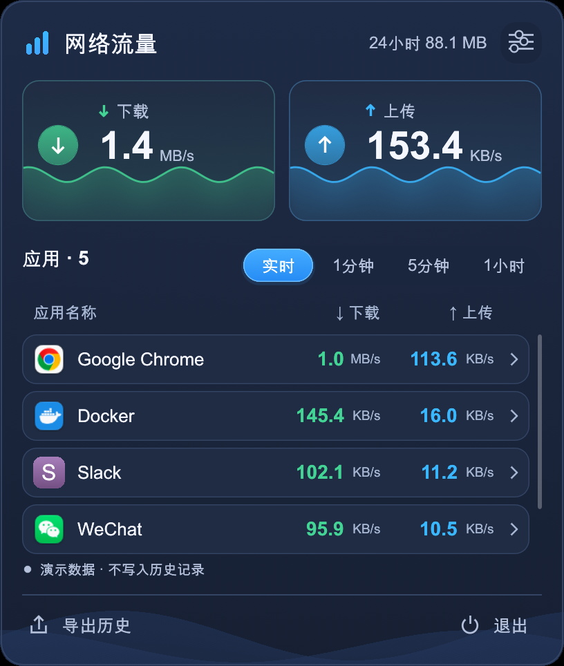
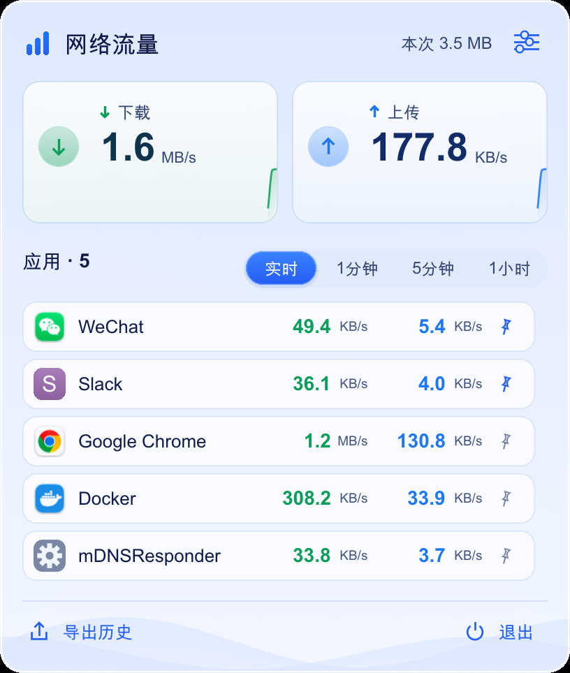

# Tramoing — Network Speed & Traffic Monitor

[简体中文](README.md) · [English](README.en.md)

**Tramoing is a lightweight, open-source network speed and traffic monitor for the Windows taskbar and macOS menu bar.** See real-time upload and download speeds, find which apps use your bandwidth, and track local traffic history. Optional CPU/GPU usage and temperature displays bring system monitoring to the same panel.

Built with Rust and egui. No Electron, Python, or other external runtime is required to run the app.

[Download the latest release](https://github.com/kkltgood/tramoing/releases/latest) · [Release history](https://github.com/kkltgood/tramoing/releases) · [Report an issue](https://github.com/kkltgood/tramoing/issues) · [Development guide (中文)](docs/development.md) · [MIT License](LICENSE)

## Preview

| Dark theme | Light theme |
| --- | --- |
|  |  |

These screenshots show a Windows demo instance. macOS shares the panel layout; per-app network blocking is currently Windows-only.

## Features

- **Real-time network speed:** upload/download rates and recent traffic graphs, with live, 1-minute, 5-minute, and 1-hour views.
- **Per-app bandwidth monitoring:** identify busy applications and pin important apps to the top, even when they have no traffic.
- **Taskbar and menu bar widgets:** compact network speed and optional CPU/GPU usage and temperatures, with configurable colors and refresh intervals.
- **Local IP address:** centered in the panel footer, refreshed automatically, with click-to-copy.
- **Traffic history:** local SQLite storage, configurable retention, CSV export, and per-app traffic alerts.
- **Windows application firewall controls:** block or restore network access for a selected executable, including connections through local proxies. Requires the bundled administrator helper.
- **Error reporting:** errors offer to export diagnostic logs through a dialog; reports stay on your device and are not uploaded automatically.
- **Desktop integration:** light/dark/system themes, a language dropdown with system preference, Simplified Chinese and English, animated settings tabs, optional launch at login, and in-app updates. Language changes apply and save immediately; translation resources support adding more languages. Downloads support pause/resume, automatic retries after disconnections, and saved progress across app restarts; the complete installer must pass SHA-256 verification.

## Download and install

Download the installer for your system and processor from [GitHub Releases](https://github.com/kkltgood/tramoing/releases/latest):

| System | Package |
| --- | --- |
| Windows 10/11, Intel or AMD 64-bit | `Tramoing-<version>-windows-x64-setup.exe` |
| Windows 11, ARM64 | `Tramoing-<version>-windows-arm64-setup.exe` |
| macOS 11+, Apple Silicon | `Tramoing-<version>-macos-arm64.dmg` |
| macOS 11+, Intel | `Tramoing-<version>-macos-x64.dmg` |

Windows installers include the matching network collection helper; administrator permission is required to install it. On macOS, open the DMG and drag Tramoing to Applications, or double-click the app and confirm installation. A fresh installation reveals the panel once near its menu bar item; upgrades restart in the background. Linux is not supported.

Every package has a SHA-256 checksum. Windows installers are currently unsigned; macOS packages use ad-hoc signing and are not Developer ID signed or notarized.

## Temperature and network limitations

Temperature readings depend on available hardware sensors. macOS uses supported AppleSMC sensors. Windows x64 CPU temperature uses an isolated built-in LibreHardwareMonitor 0.9.6 component managed by the elevated helper. The installer includes its runtime and selects CPU temperature support by default to install the official signed PawnIO 2.2 driver. No separate monitor application is required. GPU temperature prefers WDDM and falls back to built-in GPU sensors (NVAPI for NVIDIA); existing LibreHardwareMonitor/OpenHardwareMonitor WMI providers remain optional fallbacks. ARM64 and some older CPU families currently lack built-in sensor support; the application still runs and explains the missing reading. Unavailable sensors display `--°C`. Hiding temperatures stops the worker after its short request lease expires. Uninstalling Tramoing retains the shared PawnIO driver for other applications.

Traffic is attributed to applications and may differ from network adapter counters or ISP billing. Loopback traffic is excluded. On Windows, proxy traffic generally belongs to the proxy process; macOS attempts client attribution, with limits for short connections, proxy chains, and TUN configurations. See the [troubleshooting and accounting guide (中文)](docs/troubleshooting.md).

## Build from source

Install Rust stable. Windows also needs the MSVC C++ build tools and Windows SDK; macOS needs Xcode Command Line Tools.

```sh
git clone https://github.com/kkltgood/tramoing.git
cd tramoing
cargo run -p tray-app --locked -- --mock --show
```

`--mock` uses demo traffic without starting the collector or saving traffic history. Settings can still be saved; set `TM_DATA_DIR` to a separate directory for isolated testing. For production packaging, native validation, and release instructions, see the [development guide (中文)](docs/development.md).

## Data and feedback

Settings, history, and logs are stored locally in `%LOCALAPPDATA%\Tramoing\` on Windows or `~/Library/Application Support/Tramoing/` on macOS. Diagnostic export requires your confirmation and does not upload the report. Review logs before sharing them: error details may include local paths.

Use the error dialog or **Settings → General → Diagnostics & feedback** to export a report, then include it with your OS version, app version, and reproduction steps in an [issue](https://github.com/kkltgood/tramoing/issues).

Tramoing is available under the [MIT License](LICENSE). Contributions are welcome.
