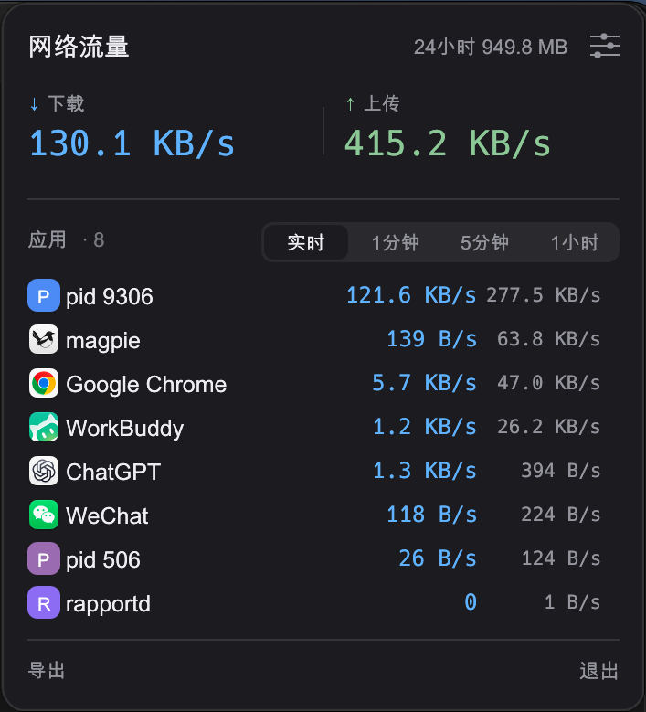
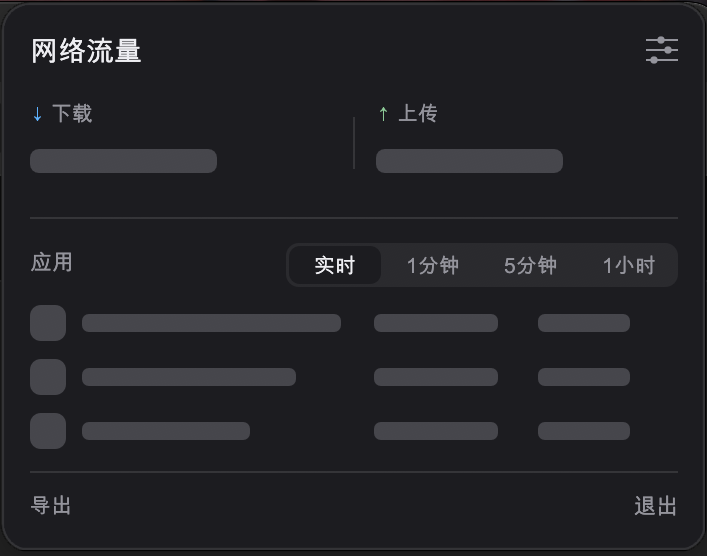
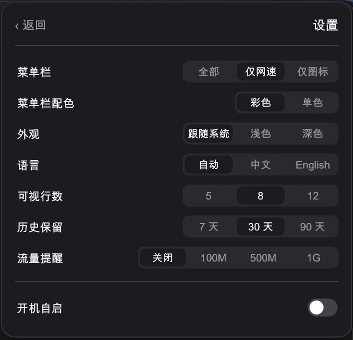

# Traffic Monitor

跨平台（macOS / Windows）菜单栏流量监控工具。状态栏一个图标，点一下弹出小面板，实时显示「哪些程序在用流量、各占多少下行 / 上行带宽」。

- **版本**：0.1.0
- **技术栈**：纯 Rust + egui / eframe，无 Electron、无 Python、无外部运行时
- **当前状态**：macOS 已完成并打包验证；Windows 代码完成、已通过交叉编译检查，**等待真机功能测试与 ETW 事件表校准**（见 [第 6 节](#6-windows-真机测试指南)）



---

## 1. 功能清单

### 1.1 菜单栏

- 波形图标 + 速率文字；速率每秒刷新一次
- 上传 / 下载**上下两行**显示，上行绿箭头、下行蓝箭头，数字保持系统色（保证可读性）
- 三档显示模式：`图标+网速` / `仅网速` / `仅图标`，运行时切换即时生效
- 可选「单色」模式，全部文字跟随系统色
- 鼠标悬停显示完整数值（菜单栏里只放得下缩写）

### 1.2 弹出面板

- 顶部两个大数字：下载 / 上行，等分两栏，直接显示本帧速率、不做数字缓动动画
- 应用列表：应用图标 + 名称 + 下行速率 + 上行速率，两列数字定宽右对齐
- 列表最多显示 8 个应用（设置里可改 5 / 8 / 12），超出可滚动
- 时间窗口四档：`实时` / `1分钟` / `5分钟` / `1小时`，决定列表按哪段时间聚合排序
- 标题栏显示最近 24 小时（或本次运行）累计流量
- 近 10 分钟单应用流量超阈值时给一行提醒
- 失焦自动收起，点击菜单栏图标可开可关
- 深色 / 浅色 / 跟随系统三档外观，中文 / 英文 / 自动三档语言

### 1.3 数据与设置

- SQLite 历史库，按**分钟**存增量，默认保留 30 天
- CSV 导出（界面按钮或命令行 `--export`）
- 开机自启开关（界面或命令行）
- 设置写成纯文本 `settings.conf`，坏文件不会导致程序起不来

### 1.4 界面截图

| 状态 | 截图 |
|---|---|
| 数据面板 |  |
| 加载骨架屏 |  |
| 设置页 |  |

---

## 2. 目录结构

```text
traffic-monitoring/
├── Cargo.toml                     # workspace 定义，版本 0.1.0 / edition 2021
├── Cargo.lock
├── README.md                      # 本文档
├── assets/                        # 图标源（gen-icon.rs 生成 PNG / icns）
├── crates/
│   ├── tm-core/                   # 平台无关的速率/窗口聚合核心
│   ├── tm-sampler/                # Sampler trait + MockSampler
│   ├── tm-macos/                  # macOS：nettop 采集、应用归并、原生状态栏
│   ├── tm-windows/                # Windows：ETW 助手、命名管道、进程路径
│   ├── tm-store/                  # SQLite 历史库（rusqlite bundled）
│   ├── tm-spike-mac/              # macOS 探针小程序（开发用）
│   └── tray-app/                  # egui 面板 + 设置 + 自启 + 采样线程
├── packaging/
│   ├── macos/Info.plist
│   └── windows/                   # NSIS 安装包 + build.ps1
├── scripts/package-macos.sh       # macOS 打包：.app + DMG
└── docs/screenshot-*.png
```

---

## 3. 架构

### 3.1 分层

| crate | 职责 | 是否依赖系统 API |
|---|---|---|
| `tm-core` | 累计值差分、EMA 平滑、按应用归并、1m/5m/1h 窗口聚合 | 否，纯逻辑 |
| `tm-sampler` | `Sampler` trait 与演示数据实现 | 否 |
| `tm-macos` | `nettop` 子进程 + pty、pid→应用归并、AppKit 图标/状态栏 | 仅 macOS |
| `tm-windows` | ETW 会话、聚合、命名管道协议、进程路径解析 | 仅 Windows |
| `tm-store` | SQLite 建表/写入/查询/清理/CSV 导出 | 否（SQLite 已 bundled） |
| `tray-app` | 采样线程、界面、设置、自启、导出 | 平台相关部分用 cfg 隔离 |

**关键约束**：`tm-core`、`tm-sampler`、`tm-store` 以及 `tm-windows` 的 `proto` / `agg` 模块完全不碰系统 API，所以能在 macOS 上直接跑单测。这也是 87 个测试里有一半以上与平台无关的原因。

### 3.2 数据流

```text
macOS:
  nettop -P -x -l 0 -s 1 -J bytes_in,bytes_out
      └─(pty，行缓冲)→ tm-macos::NettopSampler → 每秒一帧累计值

Windows:
  tm-helper.exe（管理员，登录自启）
      └─ ETW: Microsoft-Windows-Kernel-Network
      └─ Aggregator（按 PID 累加累计字节）
      └─ \\.\pipe\traffic-monitor-v1（每秒一帧，手写小端协议）
      └─ WindowsSampler（普通权限的界面进程只读管道）

两条支路汇合：
  Sampler → tm_core::RateCalculator（差分 + 平滑 + 按应用归并）
          ├─→ 面板：实时速率 + 1m/5m/1h 窗口
          ├─→ tm_store::Store（每 5 秒落一次增量，按分钟upsert）
          └─→ 24 小时合计（每 30 秒查一次库）
```

### 3.3 几个关键设计决策

| 决策 | 原因 |
|---|---|
| 采样器送**累计值**，统一由 `RateCalculator` 差分 | macOS 与 Windows 复用同一套速率链路；进程重启归零时按「重新计」处理，不产生负数 |
| 速率平滑 alpha=0.7，并按真实帧间隔换算 `1-(1-alpha)^dt` | 0.5 会让数字慢半拍；按 dt 换算后采样抖动不影响观感 |
| **第一帧快照不下发** | 第一帧只能建基线、速率必然全 0，下发会先闪一下「没有流量」；界面停在骨架屏等第二帧 |
| 按分钟存**增量**，主键 `(minute, app)` | 查询直接 `SUM`，不用处理进程重启归零；1 小时和 24 小时视图共用一张表 |
| 历史库开 WAL | 后台写盘与界面查询不互相阻塞 |
| 界面线程只渲染 | 起子进程、读流、syscall、写库全在采样线程，弹窗不会因为 IO 掉帧 |
| 管道协议手写小端编码 | 一帧只有几个数字加进程名，省掉 serde/bincode 依赖和编译时间 |
| macOS 给 `nettop` 开 pty | `nettop` 的 stdout 接管道时走 4KB 全缓冲，`-s 1` 实际 3 秒才吐一帧；接 tty 才是精确 1 秒 |
| Windows 拆成两个进程 | ETW 按进程统计必须提权；助手提权跑，托盘程序始终普通权限 |

---

## 4. 通用开发命令

工具链：Rust 1.89.0（edition 2021），无需额外系统依赖即可跑单测。

```bash
cargo test                       # 全部 87 个单测
cargo build                      # debug 构建整个工作区
cargo build --release -p tray-app

# 交叉检查（在 macOS 上可检查 Windows 侧的纯逻辑部分）
cargo check --target x86_64-pc-windows-msvc -p tm-core -p tm-sampler -p tm-windows
```

### 4.1 命令行参数（`traffic-monitor`）

| 参数 | 作用 |
|---|---|
| `--mock` | 用演示数据跑完整界面，不需要采样权限 |
| `--show` | 启动后立即展开面板（默认隐藏，只出状态栏图标） |
| `--settings` | 启动后直接打开设置页 |
| `--export` | 无界面导出全部历史为 CSV，打印结果后退出 |
| `--autostart [on\|off\|status]` | 查询 / 修改开机自启，不启动界面 |

macOS 上必须放进 `.app` 包运行，直接跑 `target/debug/traffic-monitor` 会看到「图标不出现」的假象——裸二进制的状态栏窗口 `isOnActiveSpace = false`，系统不渲染它。

### 4.2 环境变量（调试用）

| 变量 | 作用 |
|---|---|
| `TM_FORCE_MOCK=1` | 等价于 `--mock` |
| `TM_SHOW_ON_START=1` | 等价于 `--show` |
| `TM_VIEW=settings` | 启动时显示设置页 |
| `TM_WINDOW=1m\|5m\|1h` | 固定初始时间窗口 |
| `TM_TRACE=1` | 打印采样帧间隔（macOS 还打印状态栏窗口诊断信息） |
| `TM_TRAY_PNG=/tmp/x.png` | macOS：把状态栏按钮离屏渲染成 PNG（状态项被折叠进 `«` 时唯一可靠的检查手段） |
| `TM_NETTOP_BIN` | 覆盖 `nettop` 路径 |
| `TM_DB_PATH` | 覆盖历史库路径 |
| `TM_PANEL_Y` / `TM_SCROLL` | 截图时调整面板位置 / 列表滚动位置 |

---

## 5. macOS

### 5.1 本地运行

```bash
rustup target add aarch64-apple-darwin x86_64-apple-darwin
cargo run -p tray-app -- --show            # 开发调试
cargo run -p tray-app -- --show --mock     # 只看界面
open dist/TrafficMonitor.app               # 验证真实形态（推荐）
```

免 root：采集用的是系统自带的 `nettop`，不读 raw socket。

### 5.2 打包

```bash
./scripts/package-macos.sh           # .app + DMG（两个 target 都装了会做通用二进制）
./scripts/package-macos.sh --no-dmg  # 只出 .app
```

产物：`dist/TrafficMonitor.app`（约 12 MB，arm64 + x86_64 通用二进制）、`dist/TrafficMonitor-0.1.0.dmg`（约 6.6 MB）。

签名是 **ad-hoc**（`codesign -s -`）：本机跑没问题，发给别人会被 Gatekeeper 拦，需要右键「打开」或 `xattr -dr com.apple.quarantine`。正式分发需要 Developer ID + notarytool 公证。

### 5.3 已知现象

- 菜单栏被其他图标塞满时，系统会把本应用收进 `«` 折叠区，看起来像"图标没出现"。收掉一两个不常用图标即可，与程序无关。
- 应用图标取自 `NSWorkspace`，取不到时退化为首字母色块；Chrome 等应用的 helper 进程会归并到最外层 `.app`，不会重复占位。

---

## 6. Windows 真机测试指南

> 本节是给今晚在 Windows 上做验证准备的。**Windows 侧尚未在真机跑过**，安装包脚本也未在本机执行（开发环境是 macOS，只能做交叉编译检查）。请按下面顺序测。

### 6.1 环境准备

1. Visual Studio Build Tools（MSVC 链接器 + Windows SDK）
2. Rust 工具链（安装时选 `x86_64-pc-windows-msvc` 默认目标）
   ```powershell
   rustup default stable-x86_64-pc-windows-msvc
   rustc --version
   ```
3. 仅打包安装包才需要 NSIS 3：`winget install NSIS.NSIS`

### 6.2 第一步：不开助手，先验证界面

```powershell
cargo run -p tray-app -- --show --mock
```

用演示数据跑通整条 UI 链路：面板弹出、两栏速率、应用列表、时间窗口切换、设置页、主题与语言、导出。这一步**不需要管理员权限**，如果这里就有问题，先不要往下走。

### 6.3 第二步：开启真实采集

Windows 拿「每进程流量」必须提权。仓库里把它拆成两个可执行文件：

- `traffic-monitor.exe`：托盘 + 面板，普通权限
- `tm-helper.exe`：ETW 采集，登录时以最高权限静默运行

**手动开发验证**：

```powershell
# 普通 PowerShell：编译
cargo build --release -p tray-app
cargo build --release -p tm-windows --bin tm-helper

# 管理员 PowerShell：注册采集助手
# 先确定 tm-helper.exe 最终位置，--install 会把当前路径写进计划任务
# 装好之后不要再移动这个文件，否则任务会指向旧路径
.\target\release\tm-helper.exe --install

# 确认任务已注册并正在运行
schtasks /Query /TN TrafficMonitorHelper /FO LIST

# 普通 PowerShell：启动界面
.\target\release\traffic-monitor.exe
```

日志位置：

- 助手运行日志：`%LOCALAPPDATA%\TrafficMonitor\helper.log`
- ETW 事件诊断：`%LOCALAPPDATA%\TrafficMonitor\etw-dump.log`（仅 `--dump-events` 时产生）

`--install` 注册的是**登录时以最高权限运行的计划任务**（`schtasks /SC ONLOGON /RL HIGHEST`），不是 Windows 服务；`--uninstall` 会停任务、删任务、杀掉助手进程。

### 6.4 第三步：功能测试用例

| # | 操作 | 预期结果 | 备注 |
|---|---|---|---|
| T1 | 启动 `traffic-monitor.exe` | 托盘出现波形图标，**不自动弹出面板** | 见 6.6「启动就弹面板」 |
| T2 | 单击托盘图标 | 弹出面板；再点一次收起 | 失焦约 0.3 秒后也会自动收起 |
| T3 | 打开面板观察数值 | 每秒更新一次；顶部下载 / 上行两栏等宽 | 不需要等 2~3 秒 |
| T4 | 进行一个已知方向的传输（如下载一个大文件） | 下行数字明显上升，上行不应同步暴涨 | 若相反，执行 6.5 校准 |
| T5 | 打开 Chrome 等有多进程的程序 | 列表里合并为**一行**，不是五六个 `chrome.exe` | Windows 按 exe 全路径归并 |
| T6 | 依次点击 `实时 / 1分钟 / 5分钟 / 1小时` | 列表内容随之变化，滑块滑到对应档位 | |
| T7 | 设置页逐项切换：外观、语言、可视行数、保留天数、流量提醒 | 立即生效，关闭再打开设置仍保留 | 配置在 `%LOCALAPPDATA%\TrafficMonitor\settings.conf` |
| T8 | 设置里打开「开机自启」 | 注册表 `HKCU\Software\Microsoft\Windows\CurrentVersion\Run\TrafficMonitor` 出现 | 命令行 `traffic-monitor.exe --autostart status` 可交叉验证 |
| T9 | 等待 10 秒后查看数据目录 | 生成 `history.db`，且大小不再为 0 | 每 5 秒落一次盘 |
| T10 | 点击面板左下「导出」 | `Downloads` 下出现 `TrafficMonitor-<时间戳>.csv` | 没有 Downloads 目录时退到应用数据目录 |
| T11 | 运行 `traffic-monitor.exe --export` | 终端打印导出行数与路径，程序立即退出 | 无界面 |
| T12 | 注销并重新登录 | 托盘自动出现，助手任务自动以最高权限运行 | 验证计划任务 |
| T13 | `tm-helper.exe --uninstall` 后再启动界面 | 面板停在骨架屏、没有应用列表；控制台打印"连不上采集助手"，每 2 秒重连一次 | 助手是进程级数据的前提；助手恢复后界面会自动重连 |
| T14 | 运行 NSIS 安装包，再运行卸载程序 | 安装到 `Program Files\Traffic Monitor`；卸载时先停任务再删文件；历史数据默认保留 | 安装包脚本**尚未真机验证**，请重点记录问题 |

### 6.5 【重点】ETW 事件方向校准

这是 Windows 侧**唯一依赖记忆而非规范**的部分，请在真机上确认一次。

`Microsoft-Windows-Kernel-Network` 的事件数据前 8 字节是 `PID:u32, Size:u32`，代码靠事件 ID 判断方向：

```rust
// crates/tm-windows/src/etw.rs
10 | 12 | 14 | 16 => Tx   // 发送
11 | 13 | 15 | 17 => Rx   // 接收
```

**校准步骤**：

1. 先停掉正在运行的助手，避免同名 ETW 会话冲突：
   ```powershell
   schtasks /End /TN TrafficMonitorHelper
   taskkill /IM tm-helper.exe /F
   ```
2. 在**管理员** PowerShell 里运行诊断模式（窗口是隐藏子系统，Ctrl+C 不一定生效，停止用 `taskkill`）：
   ```powershell
   .\target\release\tm-helper.exe --dump-events
   ```
3. 制造**只有单一方向**的流量。推荐：在内网起一个 HTTP 服务，用 `curl -O` 只下载一个大文件；再用 `curl -T` 只上传一个大文件。
4. 每次动作后查看 `%LOCALAPPDATA%\TrafficMonitor\etw-dump.log`，形如：
   ```text
   id=14 pid=12345 size=1460 len=88 bytes=39 30 00 00 b4 05 00 00 ...
   ```
   记下「纯下载」时占多数的 `id`，以及「纯上传」时占多数的 `id`。
5. 把 `etw.rs` 里 `direction()` 的两组 ID 改成实测值，`cargo test -p tm-windows` 确认内部一致性，重新构建助手。

判定标准：改完之后，单独下载时下行数字涨、上行基本不动；单独上传时相反。若方向仍反了，说明 ID 分组需要整体对调。

> 日志里的 `size` 是**单次事件**的字节数，不是累计值；聚合由 `Aggregator` 完成。

### 6.6 故障排查

| 现象 | 可能原因 | 处理 |
|---|---|---|
| 托盘图标不出现 | 资源管理器缓存 / 图标未加载 | 重启资源管理器；确认 `traffic-monitor.exe` 进程还活着 |
| 启动就弹出面板 | eframe 首帧强制显示（已在代码里连发 3 帧隐藏命令抵消） | 若复现，请记录 Windows 版本和是否首次启动 |
| 面板一直"等待数据"、没有应用列表 | 助手没装、没提权、或崩了 | 看 `helper.log`；确认计划任务状态；`tm-helper.exe --help` 会把用法写进 `helper.log` |
| 有总流量但没有进程级数据 | helper 未运行或管道连不上 | 管理员运行 `--install`；检查 `\\.\pipe\traffic-monitor-v1` 是否存在 |
| 上下行数字对调 | ETW 事件 ID 表不对 | 执行 6.5 |
| 进程名显示为 `pid 1234` | 进程刚退出，或即使提权也查不到路径 | 正常降级，不影响流量统计 |
| 数据不更新 | ETW 会话被同名会话占用 | `tm-helper.exe --uninstall` 后重装；检查是否有旧助手进程 |
| `makensis` 找不到 | 没装 NSIS | `winget install NSIS.NSIS` |

### 6.7 Windows 已知差异与未验证项

请测试时特别留意，这些**不是 bug 或已有明确说明**：

1. **ETW 事件 ID 表待校准**（6.5）——目前唯一未经真机确认的核心逻辑。
2. **安装包脚本未真机验证**：`packaging/windows/build.ps1` 与 `traffic-monitor.nsi` 只在 macOS 上做过静态检查。
3. **托盘文字三档在 Windows 无效果**：`tray-icon` 不支持文字标题，只有图标；「菜单栏配色」同理。这两项设置只影响 macOS。
4. **列表里是首字母色块，不是真实应用图标**：Windows 侧还没有用 `SHGetFileInfoW` 取图标，目前留了接口。
5. **未做代码签名**：安装包会触发 SmartScreen 警告。
6. 滚轮手感、极端长会话（>24h）的内存表现尚未验证。

---

## 7. 配置与数据文件

### 7.1 `settings.conf`

位置：macOS `~/Library/Application Support/TrafficMonitor/`；Windows `%LOCALAPPDATA%\TrafficMonitor\`。

| 键 | 取值 | 默认 | 说明 |
|---|---|---|---|
| `tray_mode` | `both` / `speed` / `icon` | `both` | 旧值 `full`→`both`、`compact`→`speed` 自动兼容 |
| `theme` | `system` / `light` / `dark` | `system` | |
| `lang` | `auto` / `zh` / `en` | `auto` | auto 按是否有中文字体决定 |
| `row_limit` | 3~20 | `8` | 列表最多显示几行 |
| `retention_days` | 1~365 | `30` | 历史保留天数 |
| `alert_mb` | 0~1048576 | `0` | 近 10 分钟单应用超阈值提醒，0 关闭 |
| `tray_color` | `on` / `off` | `on` | 仅 macOS 有效 |

文件是 `key=value` 纯文本，解析永不失败：未知键和非法值直接忽略，用默认值兜底。

### 7.2 数据文件

| 文件 | 位置 | 说明 |
|---|---|---|
| `history.db` | 同 `settings.conf` 目录 | SQLite，WAL 模式，表 `samples`，主键 `(minute, app)` |
| `settings.conf` | 同上 | 用户设置 |
| `helper.log` | 同上（Windows） | 采集助手运行日志 |
| `etw-dump.log` | 同上（Windows） | 事件诊断日志，仅 `--dump-events` 时产生 |
| `TrafficMonitor-<时间戳>.csv` | `Downloads`，失败退到应用目录下的 `exports/` | 导出结果 |

`history.db` 可以用任何 SQLite 工具打开，例如 `sqlite3 history.db "select * from samples limit 5;"`。

---

## 8. 测试与质量

- **87 个单元测试全部通过，0 编译警告**
  - `tm-core` 21：速率差分、pid 复用、计数器回退、窗口补零、格式化
  - `tm-macos` 20：nettop 帧切分、应用归并、pty 换行、状态栏渲染辅助
  - `tm-windows` 14：管道协议编解码、按 PID 聚合、方向表一致性
  - `tray-app` 21：设置解析、自启 plist、CSV 导出、名称截断
  - `tm-store` 9：建表、upsert、范围查询、清理
  - `tm-sampler` 2：trait 与 Mock
- `cargo check --target x86_64-pc-windows-msvc -p tm-core -p tm-sampler -p tm-windows` 通过——注意这只覆盖纯逻辑 crate，**不代表 Windows 系统调用部分已经编译验证过**。

---

## 9. 提交前检查

- `.gitignore` 已忽略 `target/`、`dist/`、`.workbuddy/`、`.DS_Store`
- `docs/screenshot-*.png` 是随文档一起提交的截图
- `assets/AppIcon.icns` 已生成并提交，打包脚本在文件存在时不会重新生成
- 当前仓库还没有任何 commit，所有源码均为未跟踪状态；首次提交建议：
  ```bash
  git add .
  git commit -m "feat: cross-platform menu bar traffic monitor v0.1.0"
  ```

## 10. 许可

MIT（见根 `Cargo.toml` 的 `license` 字段）。
