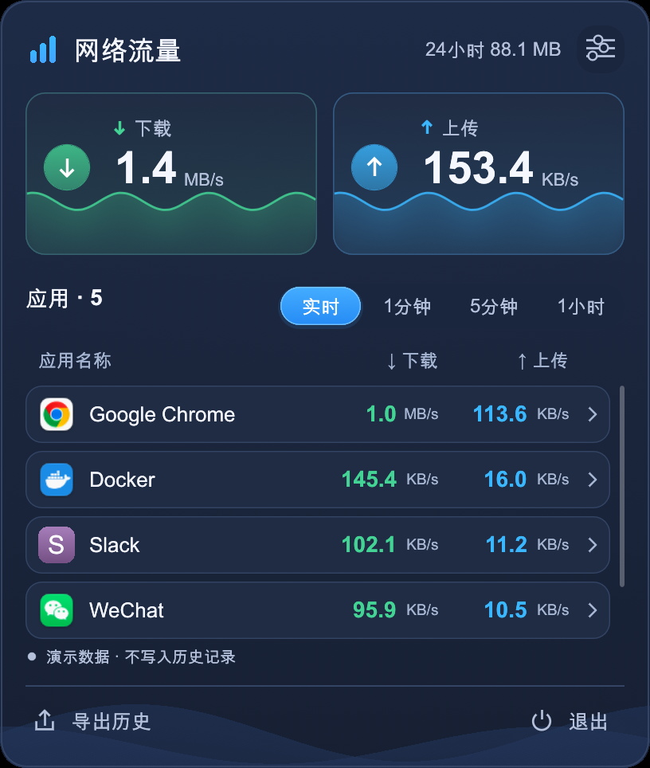

# Tramoing

轻量的 Windows 任务栏 / macOS 菜单栏流量监控工具，使用 Rust 和 egui 构建。

查看哪些应用正在使用网络、各自的上传和下载速率，以及可选的 CPU / GPU 使用率。数据保存在本机，运行时无需 Electron、Python 或其他外部运行环境。

[下载 Releases](https://github.com/kkltgood/tramoing/releases) · [开发与打包](docs/development.md) · [配置与故障排查](docs/troubleshooting.md) · [MIT 许可证](LICENSE)

## 界面

| 深色 | 浅色 |
| --- | --- |
|  |  |

截图来自 macOS 演示模式；Windows 使用相同的主面板，任务栏区域采用原生控件。

## 功能

- **实时流量**：按应用汇总上传 / 下载速率，提供实时、1 分钟、5 分钟和 1 小时视图，以及近期流量曲线。
- **任务栏和菜单栏**：双行网速，可选 CPU / GPU 使用率；支持彩色、单色和自定义颜色。Windows 可在任务栏直接拖拽统计项排序，顺序自动保存。
- **本地历史**：SQLite 按分钟保存流量，默认保留 30 天，支持 CSV 导出和单应用流量提醒。
- **界面**：深色、浅色、跟随系统；中文和英文；失焦自动收起。每次从任务栏或菜单栏展开都回到主展示页，设置从面板右上角进入。
- **后台运行**：可选登录自启，网络与性能采样在后台线程执行。
- **应用更新**：自动检查 GitHub Releases，下载后校验 SHA-256；Windows 和已安装的 macOS 应用确认更新后自动替换并重启，保留设置和历史；设置中可关闭自动检查。

## 支持平台

| 平台 | 流量采集 | 注意事项 |
| --- | --- | --- |
| Windows 10 / 11 x64 | ETW 采集助手 | 助手需要管理员权限，界面以普通权限运行 |
| macOS 11+，Apple Silicon / Intel | 系统 `nettop` | 建议通过 `.app` 包运行并验证菜单栏行为 |

CPU / GPU 显示不依赖 Windows 网络采集助手。GPU 使用率需要驱动提供相应计数器，不支持时显示 `--%`。Windows 任务栏扩展可能受系统版本、可用空间和第三方任务栏工具影响。Linux 暂不支持。

## 从源码运行

已发布的 Windows 安装包和 macOS 通用 DMG 可在 [Releases](https://github.com/kkltgood/tramoing/releases) 下载；维护者推送版本标签后由 GitHub Actions 自动构建和发布，见[自动发布指南](docs/development.md#自动发布到-github-releases)。

准备 Rust stable 工具链。Windows 还需要 Visual Studio Build Tools 的“使用 C++ 的桌面开发”和 Windows SDK；macOS 需要 Xcode Command Line Tools。

```sh
git clone https://github.com/kkltgood/tramoing.git
cd tramoing
cargo run -p tray-app --locked -- --mock --show
```

`--mock` 使用演示数据，不连接真实采集器、不写入持久流量历史。设置仍会保存；需要隔离设置时使用开发指南中的 `TM_DATA_DIR`。

### Windows

构建主程序和采集助手：

```powershell
cargo build --release --locked -p tray-app -p tm-windows --bins
```

在管理员 PowerShell 中注册助手，然后在普通权限下启动主程序：

```powershell
# 管理员 PowerShell：记录当前助手路径，并注册登录时启动的计划任务
.\target\release\tramoing-helper.exe --install

# 普通 PowerShell
.\target\release\tramoing.exe
```

注册后不要移动助手文件。面向日常使用，建议安装 NSIS 3 后生成安装包，由安装器完成部署：

```powershell
powershell -ExecutionPolicy Bypass -File packaging\windows\build.ps1
```

产物为 `dist/Tramoing-<version>-setup.exe`。安装器会安装必需的采集助手并注册计划任务。故障诊断方法见[故障排查](docs/troubleshooting.md)。

### macOS

```sh
# 默认构建已安装的 macOS 目标；两个目标都安装时生成通用二进制
./scripts/package-macos.sh --no-dmg
open dist/Tramoing.app

# 同时生成 DMG
./scripts/package-macos.sh
```

产物位于 `dist/`。DMG 提供中英文引导、固定图标位置和 Retina 背景。打开 DMG 后可将 Tramoing 拖入 Applications，也可直接双击 Tramoing，确认“安装并打开”；安装完成会展开主面板，之后从屏幕顶部菜单栏打开。已有安装优先沿用原目录，普通账户首次安装可使用自己的 `~/Applications`。

打包 DMG 需要 Python 3.10+，脚本会在 `target/` 中准备隔离的布局工具环境。默认使用 ad-hoc 签名；正式分发可配置 Developer ID 签名和公证，见[开发指南](docs/development.md#打包)。

## 常用参数

| 参数 | 作用 |
| --- | --- |
| `--mock` | 使用演示流量和性能数据 |
| `--show` | 启动后展开面板，适合界面调试 |
| `--settings` | 直接打开设置 |
| `--export` | 导出已有历史为 CSV 后退出 |
| `--autostart on\|off\|status` | 设置或查询界面程序登录自启 |
| `--check-update` | 立即检查 GitHub Releases 中的新版本 |

新安装默认开启自动检查，启动 10 秒后检查，此后最多每天一次；macOS 收起时可能延迟到面板展开。设置 → 软件更新可切换自动检查或立即检查，也可以点击右上角版本号。已有配置中的关闭选择会保留。发现新版本后点击提示下载，校验完成后点击“更新并重启”。Windows 确认系统管理员授权后自动升级；macOS 已安装的应用在后台挂载更新包，校验并复制完整的新应用，然后退出旧版、替换并重新打开，无需再次拖拽，设置和历史记录保留。准备失败时旧程序继续运行，可直接重试。维护者可通过 `TRAMOING_UPDATE_URL` 覆盖默认更新源，详见[开发指南](docs/development.md#更新源)。

## 数据与统计口径

配置、历史和日志默认存放在：

- Windows：`%LOCALAPPDATA%\TrafficMonitor\`
- macOS：`~/Library/Application Support/TrafficMonitor/`

这些内部目录名保留兼容性，与应用的展示名称 Tramoing 不同。默认不会上传流量记录。

本工具统计应用流量，不等同于网卡计数器或运营商账单。本机回环流量被排除；Windows 的代理外网流量通常归到代理进程，macOS 会尝试回填客户端，但短连接、代理链和 TUN 场景仍有归属限制。具体边界见[统计限制](docs/troubleshooting.md#统计限制)。

## 参与开发

欢迎提交 Issue 和 Pull Request。报告问题时请附系统版本、程序版本和可复现步骤；代码结构、测试命令、原生验收和发布方式见[开发指南](docs/development.md)。

本项目采用 [MIT License](LICENSE)。第三方依赖及截图中显示的应用标识归各自权利人所有。
