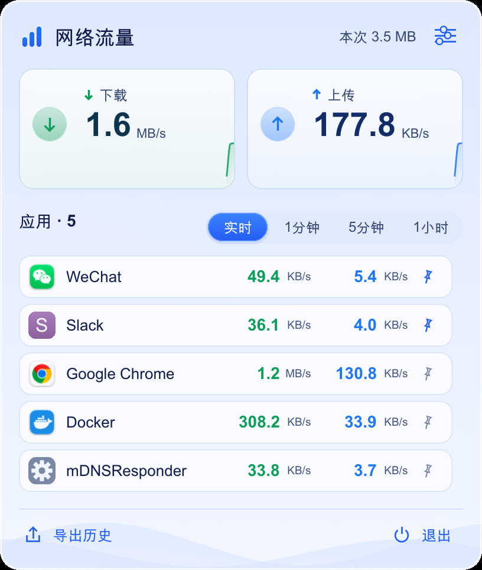
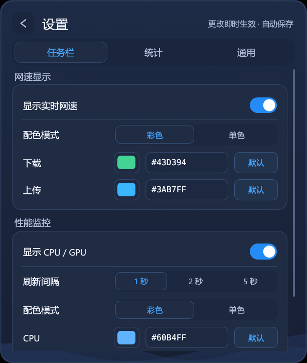

# Tramoing — 实时网速与流量监控

[简体中文](README.md) · [English](README.en.md)

**Tramoing 是一款开源、轻量的 Windows 任务栏 / macOS 菜单栏网速与流量监控工具。** 实时查看上传下载速度、应用带宽占用、流量历史，以及 CPU / GPU 使用率和温度。

An open-source network speed and traffic monitor for the Windows taskbar and macOS menu bar, with per-app bandwidth usage, local traffic history, and optional CPU/GPU monitoring. Built with Rust and egui.

查看哪些应用正在使用网络、各自的上传和下载速率，以及可选的 CPU / GPU 使用率和温度。数据保存在本机，运行时无需 Electron、Python 或其他外部运行环境。

[下载最新版](https://github.com/kkltgood/tramoing/releases/latest) · [版本记录](https://github.com/kkltgood/tramoing/releases) · [问题反馈](https://github.com/kkltgood/tramoing/issues) · [开发与打包](docs/development.md) · [配置与故障排查](docs/troubleshooting.md) · [MIT 许可证](LICENSE)

## 界面

| 深色 | 浅色 |
| --- | --- |
|  |  |

| 设置页 | 选色面板 |
| --- | --- |
|  |  |

截图来自 Windows 隔离演示实例；macOS 共用主面板和设置布局，应用断网目前仅在 Windows 提供。Windows 任务栏区域采用原生控件。

## 功能

- **实时流量**：按应用汇总上传 / 下载速率，提供实时、1 分钟、5 分钟和 1 小时视图，以及近期流量曲线。
- **本机 IP**：主面板底部显示当前网络的本机 IP 地址，自动刷新，点击即可复制。
- **应用置顶**：点击每行末尾的图钉，按置顶顺序固定在列表顶部；没有流量时仍保留，重启后记住选择，再次点击即可取消。
- **Windows 应用断网**：点击列表右侧网络图标，按所选 exe 路径阻止网络连接（包含本机代理连接）；断网后图标带斜线，再次点击恢复联网，悬停可查看操作提示。规则跨重启保留，受限程序始终保留恢复入口；列表标题旁的添加应用图标可打开独立面板，输入程序完整路径后添加并置顶，也可查看联网控制状态。需要配套新版管理员助手，macOS 暂未提供此功能。
- **任务栏和菜单栏**：双行网速，可选 CPU / GPU 使用率和温度，温度可独立显示或隐藏；支持彩色、单色和自定义颜色。Windows 可在任务栏直接拖拽统计项排序，顺序自动保存。
- **本地历史**：SQLite 按分钟保存流量，默认保留 30 天，支持 CSV 导出和单应用流量提醒。
- **界面**：深色、浅色、跟随系统；语言下拉支持跟随系统、简体中文和 English，切换即时生效并保存，后续语言可通过翻译资源扩展；失焦自动收起。每次从任务栏或菜单栏展开都回到主展示页，设置从面板右上角进入，依次为任务栏（macOS 为菜单栏）、统计、通用，首次进入默认显示任务栏设置，修改后自动保存，页签切换带选中背景滑动与内容淡入动画。
- **后台运行**：可选登录自启，网络与性能采样在后台线程执行。
- **应用更新**：自动检查 GitHub Releases，支持断点续传、断网自动重试和暂停/继续，退出程序后也保留下载进度；下载完成校验 SHA-256。Windows 和已安装的 macOS 应用确认更新后自动替换并重启，保留设置和历史；设置中可关闭自动检查。
- **故障诊断**：自动记录启动、采集、更新等错误及 Rust panic 堆栈，日志按大小轮换。发生错误时弹框询问是否导出日志，完成后可直接打开文件位置；启动失败和 Rust 崩溃提供独立原生提示。重复的同一错误在 5 分钟内合并。设置 → 通用 → 日志与故障反馈也可导出，报告仅保存在本机。

## 支持平台

| 平台 | 流量采集 | 注意事项 |
| --- | --- | --- |
| Windows 10 / 11 x64 | ETW 采集助手 | 助手需要管理员权限，界面以普通权限运行 |
| Windows 11 ARM64 | ETW 采集助手 | 使用 ARM64 原生安装包，助手需要管理员权限 |
| macOS 11+，Apple Silicon / Intel | 系统 `nettop` | 建议通过 `.app` 包运行并验证菜单栏行为 |

CPU / GPU 使用率不依赖 Windows 网络采集助手。GPU 使用率需要驱动提供相应计数器，不支持时显示 `--%`。温度显示在对应使用率旁，关闭“显示温度”会停止温度采集，保留使用率。macOS 从 AppleSMC 读取已适配的 Intel / Apple Silicon 传感器。Windows x64 的 CPU 温度由管理员助手管理的独立组件读取，使用 LibreHardwareMonitor 0.9.6；安装程序默认选中“CPU 温度支持”，部署官方签名的 PawnIO 2.2 驱动，无需另开监控软件。Windows GPU 优先读取 WDDM 驱动温度。已有 LibreHardwareMonitor / OpenHardwareMonitor 的 WMI 数据仍可作为补充来源。ARM64 及部分老型号没有内置 CPU 传感器适配，程序正常运行并提示原因；不可用时显示 `--°C`。温度取可用核心/芯片传感器中的最高值，多 GPU 的温度和使用率可能来自不同设备。Windows 任务栏扩展可能受系统版本、可用空间和第三方任务栏工具影响。Linux 暂不支持。

## 从源码运行

安装包可在 [Releases](https://github.com/kkltgood/tramoing/releases) 下载。新版发布流程按系统和处理器分别提供以下安装包，每个包均附带 `.sha256` 校验文件：

| 设备 | 安装包 |
| --- | --- |
| Windows，Intel / AMD 64 位 | `Tramoing-<version>-windows-x64-setup.exe` |
| Windows，ARM64（如 Snapdragon） | `Tramoing-<version>-windows-arm64-setup.exe` |
| macOS，Apple Silicon（M 系列） | `Tramoing-<version>-macos-arm64.dmg` |
| macOS，Intel | `Tramoing-<version>-macos-x64.dmg` |

Windows 可在“设置 → 系统 → 系统信息 → 系统类型”查看架构，macOS 可在“关于本机”查看芯片或处理器。维护者推送版本标签后由 GitHub Actions 自动构建和发布，见[自动发布指南](docs/development.md#自动发布到-github-releases)。

准备 Rust stable 工具链。Windows 还需要 Visual Studio Build Tools 的“使用 C++ 的桌面开发”和 Windows SDK；macOS 需要 Xcode Command Line Tools。

```sh
git clone https://github.com/kkltgood/tramoing.git
cd tramoing
cargo run -p tray-app --locked -- --mock --show
```

`--mock` 使用演示数据，不连接真实采集器、不写入持久流量历史。设置仍会保存；需要隔离设置时使用开发指南中的 `TM_DATA_DIR`。

### Windows

构建主程序和采集助手：

```powershell
cargo build --release --locked -p tray-app -p tm-windows --bins
```

在管理员 PowerShell 中注册助手，然后在普通权限下启动主程序：

```powershell
# 管理员 PowerShell：记录当前助手路径，并注册登录时启动的计划任务
.\target\release\tramoing-helper.exe --install

# 普通 PowerShell
.\target\release\tramoing.exe
```

注册后不要移动助手文件。面向日常使用，建议安装 NSIS 3 后生成安装包，由安装器完成部署：

```powershell
powershell -ExecutionPolicy Bypass -File packaging\windows\build.ps1
```

默认生成 `dist/Tramoing-<version>-windows-x64-setup.exe`；ARM64 使用 `-Architecture arm64`（需先安装对应 Rust target 和 C++ ARM64 生成工具，见开发指南）。安装器会安装同架构的采集助手并注册计划任务。故障诊断方法见[故障排查](docs/troubleshooting.md)。

### macOS

```sh
# 默认只构建本机架构；也可显式指定 --arch arm64 或 --arch x64
./scripts/package-macos.sh --no-dmg
open dist/macos-arm64/Tramoing.app # Intel 使用 dist/macos-x64/Tramoing.app

# 同时生成 DMG
./scripts/package-macos.sh
```

产物位于 `dist/`。DMG 提供中英文引导、固定图标位置和 Retina 背景。打开 DMG 后可将 Tramoing 拖入 Applications，也可直接双击 Tramoing，确认“安装并打开”；全新安装首次启动会在菜单栏入口附近展开主面板；升级后后台启动，从屏幕顶部菜单栏点击打开。已有安装优先沿用原目录，普通账户首次安装可使用自己的 `~/Applications`。

打包 DMG 需要 Python 3.10+，脚本会在 `target/` 中准备隔离的布局工具环境。默认使用 ad-hoc 签名；正式分发可配置 Developer ID 签名和公证，见[开发指南](docs/development.md#打包)。

## 常用参数

| 参数 | 作用 |
| --- | --- |
| `--mock` | 使用演示流量和性能数据 |
| `--show` | 启动后展开面板，适合界面调试 |
| `--settings` | 直接打开设置 |
| `--export` | 导出已有历史为 CSV 后退出；失败返回非零退出码 |
| `--export-diagnostics` | 无需启动界面或连接采集助手，导出系统信息、助手状态及最近日志后退出 |
| `--autostart on\|off\|status` | 设置或查询界面程序登录自启 |
| `--check-update` | 立即检查 GitHub Releases 中的新版本 |

新安装默认开启自动检查，启动 10 秒后检查，此后最多每天一次；macOS 收起时可能延迟到面板展开。设置 → 通用 → 启动与更新可切换自动检查或立即检查，当前版本也显示在这里。已有配置中的关闭选择会保留。发现新版本后点击提示下载，校验完成后点击“更新并重启”。Windows 确认系统管理员授权后自动升级；使用当前应用标识的 macOS 安装可在后台挂载更新包，校验并复制完整的新应用，然后退出旧版、替换并重新打开，设置和历史记录保留。macOS v0.1.4 及更早版本首次升级到 v0.1.5 时，请下载并打开新版 DMG 手动安装，以迁移应用标识。准备失败时旧程序继续运行，可直接重试。维护者可通过 `TRAMOING_UPDATE_URL` 覆盖默认更新源，详见[开发指南](docs/development.md#更新源)。

## 数据与统计口径

配置、历史和日志默认存放在：

- Windows：`%LOCALAPPDATA%\Tramoing\`
- macOS：`~/Library/Application Support/Tramoing/`

从旧版升级时，首次启动会导入旧目录中的历史、设置和待写入记录，旧目录保留为备份；新目录中已有文件不会被覆盖。Windows 主程序和助手须通过安装包一起更新。macOS 应用标识也已统一，新标识的首次升级请手动打开新版 DMG 安装。

默认不会上传流量记录。

本工具统计应用流量，不等同于网卡计数器或运营商账单。本机回环流量被排除；Windows 的代理外网流量通常归到代理进程，macOS 会尝试回填客户端，但短连接、代理链和 TUN 场景仍有归属限制。具体边界见[统计限制](docs/troubleshooting.md#统计限制)。

## 参与开发

欢迎提交 Issue 和 Pull Request。报告问题时请附系统版本、程序版本和可复现步骤；代码结构、测试命令、原生验收和发布方式见[开发指南](docs/development.md)。

本项目采用 [MIT License](LICENSE)。第三方依赖及截图中显示的应用标识归各自权利人所有。
