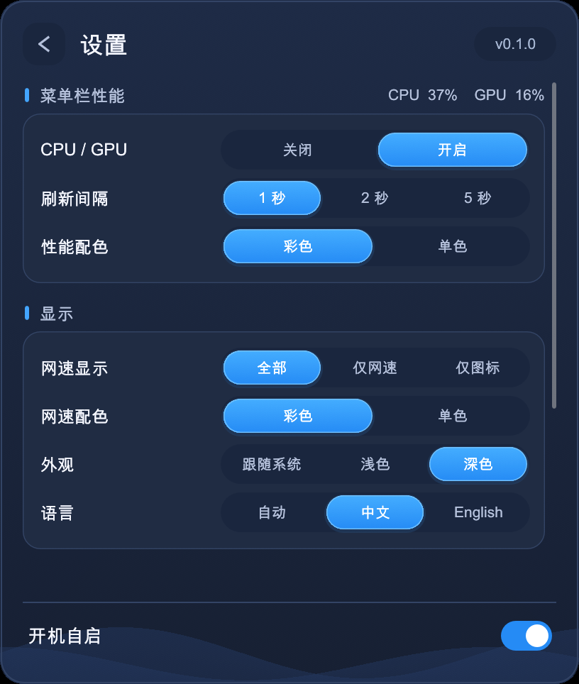
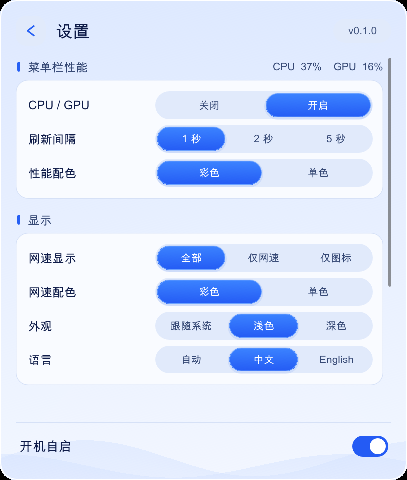

# Tramoing

跨平台（macOS / Windows）菜单栏流量监控工具。状态栏一个图标，点一下弹出小面板，实时显示「哪些程序在用流量、各占多少下行 / 上行带宽」。

> **命名说明（2026-11-18）**：产品对外名称改为 **Tramoing**（仓库目录也从 `traffic-monitoring` 改成 `tramoing`）。
> 只改「用户看得到的名字」——安装目录、快捷方式、控制面板条目、窗口标题、安装包文件名；
> 可执行文件也随之改成 `tramoing.exe` / `tramoing-helper.exe`（Cargo 的 `[[bin]]` 名一起改）。
> **真正没动的只有内部标识**：数据目录 `%LOCALAPPDATA%\TrafficMonitor`、计划任务 `TrafficMonitorHelper`、
> ETW 会话 `TrafficMonitor-Etw`、管道 `\\.\pipe\traffic-monitor-v1`、HKCU Run 值 ——
> 这些一旦改，旧版的历史数据和已注册任务就变成孤儿了，测试时分不清是程序坏了还是迁移没做。
> macOS 的 `.app` 名与 `CFBundleExecutable` 也一起改成了 `Tramoing.app` / `tramoing`，
> 但 **bundle id 与数据目录仍是 `dev.guolongkang.trafficmonitor` / `~/Library/Application Support/TrafficMonitor`**，
> 免得升级后历史记录找不到。

- **版本**：0.1.0
- **技术栈**：纯 Rust + egui / eframe，无 Electron、无 Python、无外部运行时
- **当前状态**：已完成 macOS 原生测试、双架构构建与 DMG 打包，并修复触控板列表滚动；真实采样、代理归属限制及交互验收边界见 [macOS 验证记录](docs/macos-verification-2026-11-20.md)。此前 Windows 验证见 [修复记录](docs/verification-2026-11-19.md)。
- **任务栏显示修复**：透明背景和固定箭头列的实现、实机截图与测试见 [2026-11-20 验证记录](docs/taskbar-transparency-2026-11-20.md)。
- **当前界面**：按深浅双主题设计重做主面板和设置页，新增真实流量趋势；截图、验证和运行方式见 [双主题设计记录](docs/design-refresh-2026-11-20.md)。
- **菜单栏性能**：macOS 新增同一组双行 CPU / GPU 使用率，上排 CPU、下排 GPU；支持统一开关、刷新频率和彩色／单色，见 [性能显示记录](docs/performance-menu-2026-11-20.md)。
- **Windows 性能显示**：任务栏网速旁增加双行 CPU / GPU，复用性能开关、刷新间隔和配色设置；可独立于网速显示，见 [Windows 性能记录](docs/windows-performance-2026-11-20.md)。
- **紧凑宽度与自定义颜色**：Windows 的网速与性能总宽从 114 收紧至 102 个逻辑像素，保留组间留白；macOS / Windows 均可在设置中分别选择 CPU、GPU、下载、上传颜色，也支持 `#RRGGBB` 配置，见 [配色与宽度记录](docs/display-colors-2026-11-20.md)。
- **Windows 拖动排序**：按住网速或 CPU/GPU 区域拖到另一组的前后方即可交换顺序；拖动时预览，松开后保存，重启仍保留。设置中也可切换「网速在前 / 性能在前」。
- **网速统计修复**：Windows 过滤代理回环转发，按源采样时间计算速率，历史导出改为后台只读任务；本轮测试与安装包见 [统计修复记录](docs/traffic-accounting-fixes-2026-11-20.md)。
- **代码审查修复**：修复 macOS 归属与资源管理、配置及导出文件写入、损坏历史恢复和更新下载问题；问题清单与验证边界见 [代码审查记录](docs/code-audit-2026-11-20.md)。


---

## 1. 功能清单

### 1.1 菜单栏 / 任务栏

**macOS（状态栏文字）**

- 波形图标 + 速率文字；速率每秒刷新一次
- 上传 / 下载**上下两行**显示，彩色模式下载绿、上传蓝；单色模式跟随系统色
- 三档显示模式：`图标+网速` / `仅网速` / `仅图标`，运行时切换即时生效
- 可选「单色」模式，全部文字跟随系统色
- 鼠标悬停显示完整数值（菜单栏里只放得下缩写）
- 可选的 CPU / GPU 使用率共用一个双行状态项，CPU 在上、GPU 在下，采用网速的等宽字体与行高；点击打开设置
- 「设置 → 菜单栏性能」提供一个总开关（默认关闭）、1 / 2 / 5 秒刷新和彩色／单色；关闭时停止性能采样。CPU 是整机平均使用率，多 GPU 显示最忙设备；驱动不提供 GPU 使用率时显示 `--%`
- 彩色模式下可分别选择 CPU / GPU 颜色；「显示」中可选择下载 / 上传颜色。支持色板、`#RRGGBB` 输入与恢复默认，自定义色应用到对应整行。标签与数值之间使用窄空格，保留字号并收紧横向间距。

**Windows（原生任务栏网速与性能）**

数字由 `Shell_TrayWnd` 下的原生 `WS_CHILD` 控件绘制，已移除独立 egui 置顶窗口和鼠标轮询。

- 两行上下行速率，支持系统明暗主题和彩色/单色。箭头固定在独立列，数字右对齐，速率变化不会带动箭头。
- 仅网速横向占用 40 个逻辑像素（150% 缩放时为 60px）；仅性能为 58，两组之间留 4，总宽 102（150% 缩放时为 153px）。百分比左对齐、靠近 CPU/GPU 标签，数值变化时标签保持不动。竖向任务栏空间足够时上下排列。
- 「设置 → 任务栏性能」开启 CPU / GPU（默认关闭），CPU 在上、GPU 在下；支持 1 / 2 / 5 秒刷新和彩色／单色，点击性能区域打开设置。
- 彩色模式下可独立设置 CPU / GPU / 下载 / 上传颜色，支持颜色选择器、`#RRGGBB` 和恢复默认；修改后立即生效并保存。
- 性能显示和任务栏网速开关独立；关闭性能显示会停止其采样线程。CPU 为所有处理器组的平均忙碌比例，GPU 为所有设备中最忙引擎的使用率，无法读取时显示 `--%`。
- 按住任一组拖过另一组中点可预览交换顺序，松开保存；拖回原处或移到区域外松开则取消。竖向任务栏按上下顺序调整。普通点击仍打开相应面板，拖动不会误触点击。也可在「设置 → 任务栏性能 → 显示顺序」切换。
- 性能采集使用系统 PDH 计数器，无需管理员权限，不依赖网络采集助手。GPU 需要支持相应计数器的驱动（通常为 WDDM 2.x）。
- 逐像素透明背景透出真实任务栏底色，文字使用灰度抗锯齿，避免实色方块和颜色键黑边。
- 点击整块网速区域打开面板；点击事件以控件自己的位置作为锚点。
- 随任务栏移动和隐藏；Explorer 重建后自动重新挂接。
- Win10 经典任务栏预留按钮区空间，禁用或退出时恢复。
- Win11 在托盘左侧的已知空位挂接，避开任务按钮及第三方子窗口。空间不足或布局无法识别时隐藏控件并在面板提示。
- Win11 没有公开的任意文本任务栏扩展 API；本实现不承诺所有系统版本、第三方任务栏和任务按钮布局都支持。

### 1.2 弹出面板

- 顶部两张渐变速率卡片：下载绿、上传蓝，数值和单位分层显示；最近 60 个成功采样点绘制趋势曲线，两个方向各自缩放，面板收起时继续采样
- 应用列表：图标 + 名称 + 下行速率 + 上行速率，方向列标题、定宽数字列；长名称按实际剩余宽度省略，悬停或点击行尾箭头可看完整名称、路径及所选时间窗口的速率
- 列表最多列出 10 个应用（设置里可改 5 / 10 / 20），超过可视整行数时滚动查看
- 时间窗口四档：`实时` / `1分钟` / `5分钟` / `1小时`，决定列表按哪段时间聚合排序
- 标题栏显示最近 24 小时（或本次运行）累计流量
- 近 10 分钟单应用流量超阈值时给一行提醒
- 底部一条页脚：导出历史 / 退出使用图标加文字，导出结果就地显示在中间
- 发现新版本时，页脚中间改为「v0.2.0 可用 · 点此下载」，下载完变成「点此安装」；
  这一条不占额外高度，也不会把列表挤出去
- 失焦自动收起，点击菜单栏图标可开可关
- 深色 / 浅色 / 跟随系统三档外观，中文 / 英文 / 自动三档语言

### 1.3 数据与设置

- SQLite 历史库，按**分钟**存增量，默认保留 30 天
- CSV 导出（界面按钮在后台执行，命令行 `--export` 等待完成）；只读打开已有历史库，导出期间不阻塞界面
- 开机自启开关（界面或命令行）
- 设置按「性能」「显示」「统计」分组，性能区在 macOS 称为「菜单栏性能」、Windows 称为「任务栏性能」；中间选项可滚动，各组选项同宽对齐，标题与开机自启固定在原位
- 设置写成纯文本 `settings.conf`，坏文件不会导致程序起不来

### 1.4 界面截图

| 页面 | 深色 | 浅色 |
|---|---|---|
| 主面板 |  |  |
| 设置页 |  |  |

以上是 2026-11-20 新设计的 macOS 原生渲染截图（2×，隔离演示数据），两页均为 408×482 逻辑像素。
英文及滚动状态见 [双主题设计记录](docs/design-refresh-2026-11-20.md)；Windows 任务栏的此前验收保留在 [界面优化记录](docs/ui-polish-2026-11-20.md)。

---

## 2. 目录结构

```text
tramoing/
├── Cargo.toml                     # workspace 定义，版本 0.1.0 / edition 2021
├── Cargo.lock
├── README.md                      # 本文档
├── assets/                        # 图标源：gen-icon.rs 出 PNG/icns，gen-ico.py 出 Windows 的 .ico
├── crates/
│   ├── tm-core/                   # 平台无关的速率/窗口聚合核心
│   ├── tm-sampler/                # Sampler trait + MockSampler
│   ├── tm-macos/                  # macOS：nettop 按连接采集、流量归属、应用归并
│   ├── tm-windows/                # Windows：ETW 助手、命名管道、进程路径、屏幕工作区
│   ├── tm-store/                  # SQLite 历史库（rusqlite bundled）
│   ├── tm-spike-mac/              # macOS 探针小程序（开发用）
│   └── tray-app/                  # egui 面板 + 设置 + 自启 + 采样线程 + 更新检测
├── packaging/
│   ├── macos/Info.plist
│   ├── update/                    # make-manifest.ps1：算 sha256、生成 latest.json
│   └── windows/                   # NSIS 安装包 + build.ps1
├── scripts/package-macos.sh       # macOS 打包：.app + DMG
└── docs/screenshot-*.png
```

---

## 3. 架构

### 3.1 分层

| crate | 职责 | 是否依赖系统 API |
|---|---|---|
| `tm-core` | 累计值差分、EMA 平滑、按应用归并、1m/5m/1h 窗口聚合 | 否，纯逻辑 |
| `tm-sampler` | `Sampler` trait 与演示数据实现 | 否 |
| `tm-macos` | `nettop` 子进程 + pty、按连接解析与流量归属、pid→应用归并、AppKit 图标/状态栏 | 仅 macOS |
| `tm-windows` | ETW 会话、聚合、命名管道协议、进程路径解析、屏幕工作区与任务栏明暗 | 仅 Windows |
| `tm-store` | SQLite 建表/写入/查询/清理/CSV 导出 | 否（SQLite 已 bundled） |
| `tray-app` | 采样线程、界面、设置、自启、导出 | 平台相关部分用 cfg 隔离 |

**关键约束**：`tm-core`、`tm-sampler`、`tm-store` 以及 `tm-windows` 的 `proto` / `agg` / `network` 模块完全不碰系统 API，所以能在 macOS 上直接跑单测。

### 3.2 数据流

```text
macOS:
  nettop -x -n -L 0 -s 1          # CSV，按连接
      └─(pty，行缓冲)→ tm-macos::FlowParser → FlowAccounting（归属）→ 每秒一帧累计值

Windows:
  tramoing-helper.exe（管理员，登录自启）
      └─ ETW: Microsoft-Windows-Kernel-Network
      └─ network::decode_event（解析收发方向与地址，过滤回环）
      └─ Aggregator（按 PID 收集每批增量）→ AppAccumulator（按应用累计）
      └─ \\.\pipe\traffic-monitor-v1（新采样通知推送，附带单调采集时间）
      └─ WindowsSampler（普通权限读取，跳过重复帧，按源时间差分）

两条支路汇合：
  Sampler → tm_core::RateCalculator（差分 + 平滑 + 按应用归并）
          ├─→ 面板：实时速率 + 1m/5m/1h 窗口
          ├─→ tm_store::Store（每 5 秒落一次增量，按分钟upsert）
          └─→ 24 小时合计（每 30 秒查一次库）
```

### 3.3 几个关键设计决策

| 决策 | 原因 |
|---|---|
| 采样器送**累计值**，统一由 `RateCalculator` 差分 | macOS 与 Windows 复用同一套速率链路；进程重启归零时按「重新计」处理，不产生负数 |
| 速率平滑 alpha=0.7，并按真实帧间隔换算 `1-(1-alpha)^dt` | 0.5 会让数字慢半拍；按 dt 换算后采样抖动不影响观感 |
| **第一帧快照不下发** | 第一帧只能建基线、速率必然全 0，下发会先闪一下「没有流量」；界面停在骨架屏等第二帧 |
| 按分钟存**增量**，主键 `(minute, app)` | 查询直接 `SUM`，不用处理进程重启归零；1 小时和 24 小时视图共用一张表 |
| 历史库开 WAL | 后台写盘与界面查询不互相阻塞 |
| 界面线程只渲染 | 起子进程、读流、syscall、写库全在采样线程，弹窗不会因为 IO 掉帧 |
| 管道协议手写小端编码 | 一帧只有几个数字加进程名，省掉 serde/bincode 依赖和编译时间 |
| Windows 帧尾携带可选采集时间戳 | 重复帧不更新基线，传输延迟不改变速率的分母；保留 v1 帧前缀，新旧版本可互读，旧助手回退到接收时间 |
| Windows 不计 IPv4/IPv6 回环转发 | 避免浏览器与本地代理之间的同一份数据同时抬高上下行；普通局域网流量保留，代理外网流量目前归代理进程 |
| 历史导出使用后台任务和只读数据库连接 | 大库导出不冻结面板，不执行建表/迁移或申请写锁；同一界面一次只导出一份，正常退出等待文件完成 |
| macOS 给 `nettop` 开 pty | `nettop` 的 stdout 接管道时走 4KB 全缓冲，`-s 1` 实际 3 秒才吐一帧；接 tty 才是精确 1 秒 |
| macOS 按**连接**统计，不用 `-P` 进程汇总 | 系统代理下一份下载会出现在三个 socket 上（代理外网收、代理回环发、App 回环收）。汇总口径要么算两遍（实测 6 MB 变 12.5 MB，上下行接近），要么只能记到代理名下。按连接配对后可以把回环客户端侧回填给发起方，总量只取外网连接 |
| 回环两端按「监听端口」判服务端 | 服务端那一侧和客户端侧是同一份数据，用 `state=Listen` 的端口集合就能区分，不需要猜端口号大小 |
| 代理自己的流量 = 外网 − 已回填部分 | 代理的自更新、DNS 不该被减没，也不能重复计；链式代理的第一跳没有外网流量，按「同时在服务回环且连向下一跳」也识别为中继 |
| 本机互访不计入 | 浏览器 ↔ 本地 dev server 两端都不是中继，这份流量从没上网卡，计进去只会让数字虚高 |
| TUN 模式按「量守恒」认转发进程 | `utun` 和物理网卡之间没有端口可配对，唯一可靠的关系是：转发进程的物理流量 ≈ 隧道里所有 App 的流量（略多一点点是加密开销）。认不出就退回外网口径，保证总量不翻倍 |
| 系统服务用一只齿轮，不按首字母散列 | `mDNSResponder`、`netbiosd` 这类守护进程系统压根没给图标，首字母块会让它们看起来像「某个叫 M 的应用」；齿轮是唯一既不抢戏、又能说明「这不是你装的 app」的符号。判断只看路径前缀，不猜进程名 |
| 页脚整条用 painter 画，只占一次位 | 老版页脚是 `add_space + hairline + 两个 Button` 摊出来的：每个 `allocate_*` 都会再插一次 `item_spacing`，按钮高度又跟着字形走（中英文不一样），实测比预留的 `FOOTER_BAND` 高出 12pt，把 导出/退出 顶出了面板底边，换语言还会再变一次。现在整条带子按面板底边定位、一次占位，图标和提示都画在里面，高度恒等于常量 |
| 下载绿、上传蓝，且**定义只有一份** | 绿色表示「进来」，和多数网络工具的直觉一致。上下行色同时出现在面板、macOS 菜单栏两行小字、Windows 任务栏贴片三处，所以颜色定义放在 `tm_core::color`（`download(on_dark)` / `upload(on_dark)`），三处各自转成 `Color32` / `NSColor`。以前是各写各的，面板改了色菜单栏不跟着变 |
| Windows 拆成两个进程 | ETW 按进程统计必须提权；助手提权跑，托盘程序始终普通权限 |
| Windows 网速数字不画进托盘图标，另开一个贴片窗口 | `Shell_NotifyIcon` 只接受方形小图标，`↓1.2M` 塞进去会被系统缩成一团糊；图标槽的 rect 是壳定死的，撑开 HICON 也没用 |
| 任务栏子窗口使用**逐像素 alpha** | GDI 绘制灰度字形覆盖率，转换为预乘 BGRA，再由 `UpdateLayeredWindow` 与任务栏合成；不依赖 egui 的 GL alpha 通道。空白处仅保留 1/255 覆盖率，使整块区域仍可点击。详见 [6.13](#613-windows-原生任务栏网速) |

---

## 4. 通用开发命令

工具链：Rust 1.89.0（edition 2021），无需额外系统依赖即可跑单测。

```bash
cargo test                       # macOS：149 项通过，3 项原生验收默认忽略
cargo build                      # debug 构建整个工作区
cargo build --release -p tray-app

# 交叉检查（在 macOS 上可检查 Windows 侧的纯逻辑部分）
cargo check --target x86_64-pc-windows-msvc -p tm-core -p tm-sampler -p tm-windows
```

### 4.1 命令行参数（`tramoing`）

| 参数 | 作用 |
|---|---|
| `--mock` | 用演示数据跑完整界面，不需要采样权限 |
| `--show` | 启动后立即展开面板（默认隐藏，只出状态栏图标） |
| `--settings` | 启动后直接打开设置页 |
| `--export` | 无界面导出全部历史为 CSV，打印结果后退出 |
| `--autostart [on\|off\|status]` | 查询 / 修改开机自启，不启动界面 |

macOS 上必须放进 `.app` 包运行，直接跑 `target/debug/tramoing` 会看到「图标不出现」的假象——裸二进制的状态栏窗口 `isOnActiveSpace = false`，系统不渲染它。

### 4.2 环境变量（调试用）

| 变量 | 作用 |
|---|---|
| `TM_FORCE_MOCK=1` | 等价于 `--mock` |
| `TM_SHOW_ON_START=1` | 等价于 `--show` |
| `TM_VIEW=settings` | 启动时显示设置页 |
| `TM_WINDOW=1m\|5m\|1h` | 固定初始时间窗口 |
| `TM_TRACE=1` | 打印采样帧间隔（macOS 还打印状态栏窗口诊断信息） |
| `TM_TRAY_PNG=/tmp/x.png` | macOS：把状态栏按钮离屏渲染成 PNG（状态项被折叠进 `«` 时唯一可靠的检查手段） |
| `TM_PERFORMANCE_PNG=/tmp/performance.png` | macOS：配合 `TM_TRACE=1`，保存 CPU / GPU 双行状态项的离屏渲染；需要启用性能显示 |
| `TM_NETTOP_BIN` | 覆盖 `nettop` 路径 |
| `TM_DB_PATH` | 覆盖历史库路径 |
| `TM_DATA_DIR` | 覆盖应用数据目录，隔离历史、设置、日志和实例锁；`TM_DB_PATH` 仍可单独覆盖历史库 |
| `TM_PANEL_Y` / `TM_SCROLL` | 截图时调整面板位置 / 给列表一个初始滚动位置（仅设置一次，之后连续滚动） |
| `TM_SETTINGS_SCROLL` | 设置页初始滚动位置；点击性能状态项时回到顶部 |
| `TM_TRACE_LIST` | 打印列表可用高度、能放几行、整行高度，以及设置页余量（调固定高度时用） |
| `TM_TOAST="已导出 12 行"` | 启动时先塞一条页脚提示，用来核对提示文案的排版 |
| `TM_CAPTURE_PPM` / `TM_CAPTURE_AFTER` | debug 演示模式下保存应用渲染截图并退出；必须同时设置 `TM_DATA_DIR`，默认等待 3 秒 |

---

## 5. macOS

### 5.1 本地运行

```bash
rustup target add aarch64-apple-darwin x86_64-apple-darwin
cargo run -p tray-app -- --show            # 开发调试
cargo run -p tray-app -- --show --mock     # 只看界面
open dist/Tramoing.app                     # 验证真实形态（推荐）
```

免 root：采集用的是系统自带的 `nettop`，不读 raw socket。

### 5.2 打包

```bash
./scripts/package-macos.sh           # .app + DMG（两个 target 都装了会做通用二进制）
./scripts/package-macos.sh --no-dmg  # 只出 .app
```

产物：`dist/Tramoing.app`（约 12 MB，arm64 + x86_64 通用二进制）、`dist/Tramoing-0.1.0.dmg`（约 6.6 MB）。

签名是 **ad-hoc**（`codesign -s -`）：本机跑没问题，发给别人会被 Gatekeeper 拦，需要右键「打开」或 `xattr -dr com.apple.quarantine`。正式分发需要 Developer ID + notarytool 公证。

### 5.3 已知现象

- 菜单栏被其他图标塞满时，系统会把本应用收进 `«` 折叠区，看起来像"图标没出现"。收掉一两个不常用图标即可，与程序无关。
- 应用图标取自 `NSWorkspace`，取不到时退化为首字母色块；系统服务（`mDNSResponder`、`netbiosd` 这类没有 `.app` 的守护进程）统一画齿轮，见 5.4。Chrome 等应用的 helper 进程会归并到最外层 `.app`，不会重复占位。
- 走系统代理（Clash / Surge / 公司代理）的流量会**回填给发起请求的 App**；代理进程只保留它自己的那部分流量。链式代理只记最外层一次。
- **TUN 模式**（Clash 增强模式 / WireGuard）靠「量守恒」识别转发进程：隧道侧（`utun*`）的字节回填给 App，转发进程的物理流量按隧道总量抵扣。判定条件是「没有隧道侧流量、物理流量与隧道总量最接近且比值在 0.7–3.0 之间」；认不出来时宁可不回填（总量仍然准，只是退化成只看到代理）。同一时刻只支持一个隧道转发进程。
- 采样器读的是 nettop 的 socket 字节数，不含 TCP/IP 头与 ACK，所以总量会比网卡计数器略低（实测下行 90% 左右，上行差得多一些，属正常）。
- 没有 `.app` 外壳的进程用**可执行文件全路径**当归并键（列表里显示路径里的文件名）；只有路径都读不到时（极少见）才退回 nettop 给的进程名，那种名字可能被截断到 20 字符。

### 5.4 应用图标（macOS）

三种来源，优先级从高到低：

| 行 | 图标 | 为什么 |
|---|---|---|
| 普通应用 | `.app` 的真实图标 | `NSWorkspace.iconForFile(bundle)` 拿到的就是 Finder / Dock 里那张，不用自己解 `.icns` |
| 系统服务 | 灰色齿轮 | `mDNSResponder`（`/usr/sbin`）、`netbiosd` 这类守护进程根本没有 `.app`，macOS 从来没给它们画过图标 —— Finder 和活动监视器里也是一片空白。统一发一只齿轮：既看得出「这是系统在跑的服务」，又不会和某个应用的品牌色混淆 |
| 其余 | 首字母色块 | 既没有 bundle、又不算系统服务（典型是 `/Library/Application Support/clash-verge-service/cores/verge-mihomo` 这种被服务模式复制出来的内核），按名字散列一个稳定色 |

判断依据是**归并键的路径前缀**（`tm_core::is_system_service`）：`/usr/sbin/`、`/usr/libexec/`、`/sbin/`、`/System/Library/` 算系统服务，`.app` 结尾的排除在外（`/System/Applications/Finder.app` 有自己的图标）。`/usr/bin/` 不算 —— 那是用户随手敲的 CLI（`curl`、`ssh`），全画成齿轮反而淹没了真正的后台服务。

这也正是「没有 `.app` 就用全路径当键」的原因：键退化成进程名，`/usr/sbin` 这层信息就丢了，图标层无从判断。

齿轮不是贴图，和托盘图标一样是画出来的（`crates/tray-app/src/icon.rs::gear`）：8 个齿、齿顶半径 13.9、齿根圆 9.4、中心孔 4.4（都在 36×36 的设计坐标里），4x 超采样再盒式降采样。输出纯白 + 透明底，明暗主题只改 `painter.image` 的 tint，不用烘两套图。

### 5.5 原生运行验收

在允许 `nettop` 和 AppKit 访问系统服务的终端运行：

```bash
# IPv4/IPv6 回环各传输 8 MiB，并检查采集器退出后的子进程回收
cargo test -p tm-macos --test native_runtime live_loopback --locked -- --ignored --nocapture --test-threads=1
# 终止测试自己的 nettop，检查自动重连、清除旧速率和正常退出落盘
cargo test -p tray-app live_macos_engine_recovers --locked -- --ignored --nocapture --test-threads=1
# 可选：通过指定 HTTP 代理下载 4 MiB 公共测试数据，检查客户端归属
TM_TEST_PROXY=http://127.0.0.1:7897 cargo test -p tm-macos --test native_runtime live_proxy --locked -- --ignored --nocapture --test-threads=1
```

前两项本机通过；代理归属验收本机未达到 75% 门槛，详见[记录](docs/macos-verification-2026-11-20.md)。这些测试默认忽略，不让 CI 依赖外网和桌面权限。列表滚动回归包含在常规测试中，覆盖触控板小幅输入、空闲帧、反向滚动、滚轮到底和列表缩短。

---

## 6. Windows 真机测试指南

> 本节是给今晚在 Windows 上做验证准备的。**Windows 侧尚未在真机跑过**，安装包脚本也未在本机执行（开发环境是 macOS，只能做交叉编译检查）。请按下面顺序测。

### 6.1 环境准备

1. Visual Studio Build Tools（MSVC 链接器 + Windows SDK）
2. Rust 工具链（安装时选 `x86_64-pc-windows-msvc` 默认目标）
   ```powershell
   rustup default stable-x86_64-pc-windows-msvc
   rustc --version
   ```
3. 仅打包安装包才需要 NSIS 3：`winget install NSIS.NSIS`

### 6.2 第一步：不开助手，先验证界面

```powershell
cargo run -p tray-app -- --show --mock
```

用演示数据跑通整条 UI 链路：面板弹出、两栏速率、应用列表、时间窗口切换、设置页、主题与语言、导出。这一步**不需要管理员权限**，如果这里就有问题，先不要往下走。

### 6.3 第二步：开启真实采集

Windows 拿「每进程流量」必须提权。仓库里把它拆成两个可执行文件：

- `tramoing.exe`：托盘 + 面板，普通权限
- `tramoing-helper.exe`：ETW 采集，登录时以最高权限静默运行

**手动开发验证**：

```powershell
# 普通 PowerShell：编译
cargo build --release -p tray-app
cargo build --release -p tm-windows --bin tramoing-helper

# 管理员 PowerShell：注册采集助手
# 先确定 tramoing-helper.exe 最终位置，--install 会把当前路径写进计划任务
# 装好之后不要再移动这个文件，否则任务会指向旧路径
.\target\release\tramoing-helper.exe --install

# 确认任务已注册并正在运行
schtasks /Query /TN TrafficMonitorHelper /FO LIST

# 普通 PowerShell：启动界面
.\target\release\tramoing.exe
```

日志位置：

- 助手运行日志：`%LOCALAPPDATA%\TrafficMonitor\helper.log`
- ETW 事件诊断：`%LOCALAPPDATA%\TrafficMonitor\etw-dump.log`（仅 `--dump-events` 时产生）

`--install` 注册的是**登录时以最高权限运行的计划任务**（`schtasks /SC ONLOGON /RL HIGHEST`），不是 Windows 服务；`--uninstall` 会停任务、删任务、杀掉助手进程。

### 6.4 第三步：功能测试用例

| # | 操作 | 预期结果 | 备注 |
|---|---|---|---|
| T1 | 启动 `tramoing.exe` | 托盘出现波形图标，**不自动弹出面板** | 见 6.6「启动就弹面板」 |
| T2 | 单击托盘图标 | 弹出面板；再点一次收起 | 失焦约 0.3 秒后也会自动收起 |
| T3 | 打开面板观察数值 | 每秒更新一次；顶部下载 / 上行两栏等宽 | 不需要等 2~3 秒 |
| T4 | 进行一个已知方向的传输（如下载一个大文件） | 下行数字明显上升，上行不应同步暴涨 | 若相反，执行 6.5 校准 |
| T5 | 打开 Chrome 等有多进程的程序 | 列表里合并为**一行**，不是五六个 `chrome.exe` | Windows 按 exe 全路径归并 |
| T6 | 依次点击 `实时 / 1分钟 / 5分钟 / 1小时` | 列表内容随之变化，滑块滑到对应档位 | |
| T7 | 设置页逐项切换：外观、语言、最多展示、保留天数、流量提醒 | 立即生效，关闭再打开设置仍保留 | 配置在 `%LOCALAPPDATA%\TrafficMonitor\settings.conf` |
| T8 | 设置里打开「开机自启」 | 注册表 `HKCU\Software\Microsoft\Windows\CurrentVersion\Run\TrafficMonitor` 出现 | 命令行 `tramoing.exe --autostart status` 可交叉验证 |
| T9 | 等待 10 秒后查看数据目录 | 生成 `history.db`，且大小不再为 0 | 每 5 秒落一次盘 |
| T10 | 点击面板左下「导出」 | `Downloads` 下出现 `Tramoing-<时间戳>.csv` | 没有 Downloads 目录时退到应用数据目录 |
| T11 | 运行 `tramoing.exe --export` | 终端打印导出行数与路径，程序立即退出 | 无界面 |
| T12 | 注销并重新登录 | 托盘自动出现，助手任务自动以最高权限运行 | 验证计划任务 |
| T13 | `tramoing-helper.exe --uninstall` 后再启动界面 | 面板停在骨架屏、没有应用列表；控制台打印"连不上采集助手"，每 2 秒重连一次 | 助手是进程级数据的前提；助手恢复后界面会自动重连 |
| T14 | 运行 NSIS 安装包，再运行卸载程序 | 安装到 `Program Files\Tramoing`；开始菜单出现 `Tramoing`；卸载时先停任务再删文件；历史数据默认保留 | 只验证过「生成安装包」，安装/卸载流程待测 |

### 6.5 ETW 统计口径与验证

已核对本机 `Microsoft-Windows-Kernel-Network` manifest。Version 0 的事件数据以
`PID:u32, Size:u32, daddr, saddr, dport, sport` 开头；地址按网络字节序解析。计费事件为：

```rust
// crates/tm-windows/src/network.rs
10 | 26 | 42 | 58 => Tx   // TCPv4、TCPv6、UDPv4、UDPv6 发送
11 | 27 | 43 | 59 => Rx   // 对应接收
```

连接、断开、重传等事件不计费。任意端点为 `127.0.0.0/8`、`::1` 或映射的 IPv4
回环地址时跳过；普通局域网连接仍计费。未知事件版本和截断数据直接忽略。

本地代理的外网流量目前记在代理进程名下，尚未实现 Windows 端回填给浏览器的连接配对。
纯回环传输不应增加全局上传、下载；代理下载不应再因本机转发生成近似等量的上传。

**需要管理员权限的真实采集验收步骤**：

1. 先停掉正在运行的助手，避免同名 ETW 会话冲突：
   ```powershell
   schtasks /End /TN TrafficMonitorHelper
   taskkill /IM tramoing-helper.exe /F
   ```
2. 在**管理员** PowerShell 里运行诊断模式（窗口是隐藏子系统，Ctrl+C 不一定生效，停止用 `taskkill`）：
   ```powershell
   .\target\release\tramoing-helper.exe --dump-events
   ```
3. 在另一台局域网设备上起 HTTP 服务，分别下载、上传大文件；再经本机代理执行一次下载。检查主要速率方向与实际传输一致。
4. 每次动作后查看 `%LOCALAPPDATA%\TrafficMonitor\etw-dump.log`，形如：
   ```text
   id=10 pid=12345 size=1460 len=48 bytes=39 30 00 00 b4 05 00 00 ...
   ```
   记下「纯下载」时占多数的 `id`，以及「纯上传」时占多数的 `id`。
5. 单独进行纯 `127.0.0.1` / `::1` 文件传输，确认应用全局统计不增加。诊断日志在过滤前记录事件，所以日志中仍能看到这些事件。

自动回归覆盖四类收发事件、回环过滤、代理转发和普通局域网保留；本轮未替换正在运行的提权助手进行新版本端到端实测，具体边界见 [统计修复记录](docs/traffic-accounting-fixes-2026-11-20.md)。

> 日志里的 `size` 是**单次事件**的字节数，不是累计值；聚合由 `Aggregator` 完成。

### 6.6 故障排查

| 现象 | 可能原因 | 处理 |
|---|---|---|
| 托盘图标"不出现" | Win11 默认把新图标收进任务栏的 `«` 溢出区 | 点任务栏的 `«` 展开，把图标拖到常显区；确认 `tramoing.exe` 进程还活着 |
| 托盘图标看不见/几乎是空白 | 图标颜色跟任务栏底色撞了（深色任务栏要白线、浅色要黑线，代码已按注册表自适应，每 3 秒复查一次） | 若仍异常，记录 Windows 版本 + 任务栏明暗设置 |
| 启动就弹出面板 | eframe 首帧强制显示（macOS 上连发 3 帧隐藏命令抵消；Windows 改成开局停在屏幕外） | 若复现，请记录 Windows 版本和是否首次启动 |
| 点托盘图标后看不到面板 | ① 面板被摆到屏幕外（6.8）；② 收起时把窗口真隐藏，eframe 的 `update()` 停摆，点击没人处理（6.12） | 已在 6.8 / 6.12 修复；若仍复现，`TM_TRACE_FRAMES=1` 启动看收起后 `[ui] frame=` 还在不在涨 |
| 面板一直"等待数据"、没有应用列表 | 助手没装、没提权、或崩了 | 看 `helper.log`；确认计划任务状态；`tramoing-helper.exe --help` 会把用法写进 `helper.log` |
| 有总流量但没有进程级数据 | helper 未运行或管道连不上 | 管理员运行 `--install`；检查 `\\.\pipe\traffic-monitor-v1` 是否存在 |
| 代理下载时上传、下载经常接近 | 旧助手重复计算本机回环转发 | 同时更新主程序与采集助手，再按 6.5 验证；旧历史不自动重算 |
| 进程名显示为 `pid 1234` | 进程刚退出，或即使提权也查不到路径 | 正常降级，不影响流量统计 |
| 数据不更新 | ETW 会话被同名会话占用 | `tramoing-helper.exe --uninstall` 后重装；检查是否有旧助手进程 |
| `makensis` 找不到 | 没装 NSIS | `winget install NSIS.NSIS` |

### 6.7 Windows 已知差异与未验证项

请测试时特别留意，这些**不是 bug 或已有明确说明**：

1. **Windows 代理流量归属**：已过滤回环重复计费，但代理的真实网络流量仍显示在代理名下；TUN/VPN 虚拟接口的跨层归属和去重尚未覆盖本轮验收。
2. **安装包脚本只在真机跑通了「生成」这一步**（见 6.10）：`dist\Tramoing-0.1.0-setup.exe` 已产出，但安装 → 卸载全流程、UAC 提示和 SmartScreen 拦截尚未验证。
3. **原生任务栏网速**：通过任务栏子窗口显示，具体系统支持范围与实现见 1.1 / 6.13；托盘图标仍提供速率 tooltip。
4. **少数应用仍显示首字母色块**：图标走 `SHGetFileInfoW` 从 exe 资源里取（见 6.11），
   取不到就退回首字母方块。已知取不到的一类：装在**受 ACL 保护的服务目录**里的核心程序
   （例如 `C:\ProgramData\clash-verge-service\cores\verge-mihomo.exe`），普通权限读不到文件，
   也就取不到图标。这是权限模型决定的，不是渲染 bug。
5. **未做代码签名**：安装包会触发 SmartScreen 警告。
6. 滚轮手感、极端长会话（>24h）的内存表现尚未验证。

### 6.8 本轮修复（面板定位 / 设置页高度）

之前 Windows 上有一批只在 macOS 验证过、Windows 分支从未真机跑过的逻辑，逐条修掉：

| 问题 | 原因 | 修法 |
|---|---|---|
| 面板打开位置/方向都不对 | `place_below()` 写死「在图标下方展开」——macOS 菜单栏在顶部成立，Windows 任务栏在底部就把面板顶到屏幕外 | 方向由「图标在工作区上半还是下半」决定；工作区取图标所在显示器的 `rcWork`（扣掉任务栏），副屏/竖屏也准 |
| 面板展开动画像在往下掉 | 窗口高度动画只钉了顶边 | 向上展开时每帧按当前高度重算顶边，底边始终贴着图标 |
| 悬停看不到实时速率 | `sync_tray_title()` 开头 `if !macos { return }`，把 tooltip 一起跳过了 | tooltip 提到平台分支之外，两平台每秒更新 |
| 托盘图标在深色任务栏上隐形 | 图标是给 macOS 模板图设计的纯黑 36px，Windows 照原样画 | 按注册表 `SystemUsesLightTheme` 出白线/黑线，32px；主题切换 3 秒内自动重画 |
| 面板一打开就自己关掉 | Windows 的 `SetForegroundWindow` 可能被前台规则拒绝，焦点一直为 false 就触发「失焦收起」 | 只有**曾经拿到过焦点**才允许失焦收起；没焦点时再点一次图标收起 |
| 界面全是英文 | 中文字体候选路径只有 macOS 的 | Windows 依次找 微软雅黑 / 等线 / 黑体 / 宋体，`.ttc` 用 `FontData::index` 取字面 |
| 设置里两个开关调了没反应 | 那两个选项只在 macOS 生效，却照样显示 | Windows 上不再渲染这两行 |
| 加载态只有三行灰条、下面一片空白 | 骨架屏写死画 3 行，而面板高度固定 | 骨架铺满可视行数（7 行）、逐行变淡，并画成同样的行盒；空状态文案在列表格里垂直居中 |
| 点开设置时"卡一下 + 面板变矮" | 窗口高度按内容逐帧算出来，切页/换数据都会让它变 | **面板改成固定高度 411pt**（`PANEL_H`，正好 7 行列表）：列表吃掉剩余空间并按整行裁剪，超出滚动；页脚与设置页的"开机自启"都贴底。窗口尺寸从此不再变化 |
| 列表滚动后上下各露半截行，底部还空一截 | ① 触控板停下时偏移量停在半行；② 列表下方无条件预留提醒和提示高度 | 旧版曾加入整行吸附；2026-11-20 macOS 验收发现它会吞掉触控板小幅滚动，现已移除，改由 ScrollArea 连续维护偏移。页脚及提醒仍按实际内容预留空间 |
| 设置页中间一大块空白 | 7 行设置按 32.5pt 排，面板比内容高 110pt，全堆在"流量提醒"和"开机自启"之间 | 设置行改成 37pt 一行（行高 32 + 间距 5），并把面板高度压到刚好装下：余量只剩 10pt |
| 列表看着像普通表格 | 行与行之间没有层级；`1.3 MB/s` 整串落字，单位占一半宽度；字母图标是一整块高饱和色块 | **每一行做成独立的小卡**：1px 淡描边 + 6pt 圆角 + 5pt 行距，条目边界一眼可见；数值用等宽字体、单位缩到 8.5pt 并收到固定单位列（小数点竖着对齐）；字母图标改成同色系淡底 + 亮字；悬停时底色提亮一档、描边渐变到强调色（120ms） |
| 滚动条把手压在行盒描边上 | 用的是 egui 自带的浮动把手，它画在内容矩形之内 | 关掉自带把手，改成自绘的 3pt 指示条，专门占行盒右侧的 9pt 过道；当前偏移由 ScrollArea 连续维护 |
| 菜单栏速率宽度来回跳 | 菜单栏项按标题宽度自适应，而 `compact()` 是"最短写法"：`9.9M`/`10M`、`56B`/`1.2M` 长度不同，`820K` 和 `1.2M` 长度相同但 K/M 字母宽度不同；空闲时 `0` 只有一个字符 | 速率固定成 **4 个字符**（`menu_speed`：`"  0B"`、`" 820K"`、`"1.2M"`），标题字体从"等宽数字"换成**整段等宽**（SF Mono）；实测连续 7 次刷新按钮宽度恒为 56×22（带图标 76×22） |

验证方式：`cargo test --workspace`（114 个用例，含定位几何、滚动吸附、速率定宽的单测）；
`cargo check --target x86_64-pc-windows-msvc`（`tray-app` + `tm-windows`，0 警告）。
真机行为仍需按 6.4 的用例表复测。

### 6.9 本轮修复（Windows 真机运行）

在 3840×2160 @150% 的 Windows 真机上把两条链路都跑通了（`--show --mock` 走假数据、
不带 `--mock` 走真实 ETW 助手，275 个进程、稳定 1.00s 一帧），修掉的是只有真机才暴露的问题：

| 问题 | 原因 | 修法 |
|---|---|---|
| `cargo check --workspace` 在 Windows 上直接编不过 | workspace 成员是无条件列出的，`tm-macos` / `tm-spike-mac` 没有 crate 级门控，Windows 上会去编 libc / objc2 | `tm-macos` 加 `#![cfg(target_os = "macos")]`；`tm-spike-mac` 给非 macOS 平台留一个空壳 `main` |
| 开机自启的查询/写入会闪一下黑框，环境禁掉 `reg.exe` 时整个程序起不来 | 在 `App::new()` 里 spawn `reg.exe query`，属于启动路径 | 改调 advapi32（`RegGetValueW` / `RegSetKeyValueW` / `RegDeleteKeyValueW`），落到新模块 `tm-windows::registry_run` |
| 助手被强杀过一次之后就永远起不来，日志还提示「请确认管理员权限」 | `StartTraceW` 返回 183（同名会话残留）被当成普通失败 | 183 时先探管道：通 → `AlreadyRunning` 安静退出；不通 → 按名字停掉僵尸会话再重试一次 |
| 列表底部堆一串「0 B/s / 0 B/s」的空行 | 每帧都出现的空转进程走 `a*0+(1-a)*prev`，EMA 永远到不了 0 | EMA 低于 1 B/s 一律归零并在快照里剔除；窗口视图同理 |
| 刚启动那几十秒切到「1分钟 / 5分钟 / 1小时」，数字明显偏小 | 分母写死窗口长度（60/300/3600），实际只攒了几秒 | 分母取 `min(窗口秒数, 已覆盖秒数)` |
| 进程路径含中文且超长时整帧被丢弃 | 名字按 512 字节硬切，正好切在多字节字符中间 → 对端 `from_utf8` 失败 | 截断退到最近的字符边界（`is_char_boundary`） |
| `--show` 起来一瞬间就自己收起，没法截图核对界面 | 失焦自动收起对调试模式同样生效 | `--show` 下不自动收起 |

验证：`cargo test --workspace` 97 个用例全过（Windows 上 `tm-macos` 被平台门控跳过，实跑 77）；
`tramoing.exe --autostart on/off/status`、`--export` 均实测通过。

### 6.10 打包（Windows）

仓库根目录已改成 `tramoing/`，**打包产物一律出在当前仓库根目录下的 `dist/`**，
不要再从旧路径（`traffic-monitoring/`）找安装包。

```powershell
# 需要一个能跑脚本的 PowerShell（或临时放开策略）
powershell -ExecutionPolicy Bypass -File packaging\windows\build.ps1
# 想手动指定版本
powershell -ExecutionPolicy Bypass -File packaging\windows\build.ps1 -Version 0.1.1
```

脚本做的事：读 `Cargo.toml` 的版本 → `cargo build --release --locked` 两个 exe →
从 Cargo JSON 的 `compiler-artifact.executable` 读取本次实际输出路径 →
复制到 `dist\windows\` 并逐个校验 SHA256 → 调 `makensis` 出 `dist\Tramoing-<version>-setup.exe`。
支持 `CARGO_TARGET_DIR`、Cargo 配置及目标平台子目录，不再假设产物一定在 `target\release`。

实操踩到的两个坑，已在脚本里修掉：

| 坑 | 现象 | 处理 |
|---|---|---|
| `build.ps1` / `traffic-monitor.nsi` 没存 BOM | PowerShell 5.1 按 GBK 解读，中文注释乱码 → `字符串缺少终止符`；NSIS 也会按 ANSI 读源码 | 两个文件都存成 **UTF-8 with BOM**（脚本头部有注释提醒；用编辑器改完记得补回） |
| `makensis` 不在 PATH | `winget install NSIS.NSIS` 不会写 PATH，脚本报「找不到 makensis」 | 脚本先查 `Get-Command`，再退到 `Program Files (x86)\NSIS\makensis.exe` |

已验证：安装包生成成功（0 warning），版本信息为 `Tramoing 0.1.0 / MIT`；
`dist\windows\tramoing.exe` 直接运行正常。**安装 → 卸载全流程尚未跑过**
（需要管理员权限，且会改动系统计划任务），首次安装时请留意 `tramoing-helper --install` 的返回码。

改名后安装包的行为：

- 安装目录 `%PROGRAMFILES%\Tramoing`，开始菜单文件夹 / 快捷方式 / 控制面板条目都叫 `Tramoing`，
  注册表标识 `HKLM\Software\Tramoing`（旧版的 `...\Traffic Monitor` 不会被自动卸载）。
- 装之前**先把旧版退掉**：改名前的 `traffic-monitor.exe`（或更早装的 `TrafficMonitor.exe`）如果还在跑，会和新包抢命名管道和
  ETW 会话（表现为面板一直骨架屏，日志里是 183 / 连接被拒）。
- 卸载新版时会顺手清掉旧版的残留：开始菜单 `Traffic Monitor` 文件夹、`HKCU\...\Run` 里的
  `TrafficMonitor` 值与 `HKLM\Software\TrafficMonitor*` 键。历史数据默认保留。

### 6.11 应用图标（Windows）

列表左侧的图标不是内置贴图，而是运行期从每个 exe 的资源段里取出来的真图标：

| 环节 | 实现 |
|---|---|
| 取图标 | `tm-windows::icon::app_icon(path)` → `SHGetFileInfoW`（`SHGFI_ICON \| SHGFI_LARGEICON`），150% 缩放下返回 48×48 |
| 解码 | `GetIconInfo` 拿到彩色位图 + AND mask → `GetDIBits` 读 32bpp BGRA；有 alpha 的按「预乘 → 非预乘」反算，没有 alpha 的老图标用 mask 补透明度 |
| 释放 | `GetIconInfo` 出门就把两张位图的所有权交给你，所以 `DeleteObject` 与 `DestroyIcon` 必须成对，否则每取一个图标漏两块 GDI 对象 |
| 线程 | 取图跑在 `tray-app::icons` 的后台线程里：`SHGetFileInfoW` 冷启动几十毫秒，放界面线程就是白帧 |
| 缓存 | 键直接用 `AppKey`（Windows 下就是 exe 全路径），纹理上限 256 张，超了按「10 分钟没上过榜」淘汰 |
| 兜底 | 取不到就画首字母色块（`tile_color` 按名字散列，颜色稳定） |

排查：`TM_TRACE_ICONS=1 tramoing.exe --show` 会把每个取不到的路径和原因打到 stderr。
单测在 `crates/tm-windows/src/icon.rs`（占位名/不存在路径/真实系统图标解码）。

### 6.12 本轮修复（点托盘图标没反应）

**现象**：启动后点托盘图标，面板不弹出来；托盘图标本身是在的，鼠标悬停也正常。

**原因**：收面板用的是 `ViewportCommand::Visible(false)`。窗口一旦真的隐藏，
winit 就不再派发 `RedrawRequested`，eframe 的 `update()` 整个停摆 ——
托盘点击虽然被 handler 塞进 channel（还顺手 `request_repaint()`），但再也没人消费。
更糟的是启动路径：`with_visible(false)` + 前 3 帧强制隐藏，导致 `update()`
在第一秒内就停了，连托盘图标都是靠"运气"建的。

**修法**：

| 位置 | 改动 |
|---|---|
| `main.rs` | Windows 改成开局就 `with_position([-32000, -32000])` + `with_visible(true)`：窗口一直"可见"，只是停在屏幕外，事件循环不会停 |
| `app.rs::park_window` | 收起时 Windows 用 `OuterPosition(-32000, -32000)` 挪走（`visible` 逻辑状态照旧置 false）；macOS 仍用 `Visible(false)` |
| `app.rs::App::new` | Windows 上同步 `ensure_tray()`，不再等 `update()` 里那 600ms 延迟（macOS 的 NSStatusBar 布局延迟保留） |
| `app.rs::update` | Win 专属：首帧兜底确认窗口是"可见 + 停在屏幕外"；`startup_hide` 只在 macOS 编译 |

**验证**：用 `PostMessage(hwnd, WM_USER_TRAYICON=6002, 0, WM_LBUTTONUP)`
向 `tray_icon_app` 窗口模拟点击，连续三轮「开 → 收 → 开」都正确：
打开时窗口在 `(2127, 973)`，收起时回到 `-32000` 屏幕外，面板内容完整渲染。
`TM_TRACE_FRAMES=1` 可以看到收起后 `[ui] frame=` 依旧每 30 帧打一次（说明 update 没停）。

### 6.13 Windows 原生任务栏网速

实现位于 `tm-windows/src/badge.rs`，界面只下发文字和颜色。控件在创建时即指定 `Shell_TrayWnd` 为父窗口，使用 `WS_CHILD`，没有 `WS_EX_TOPMOST`、颜色键透明或额外的 egui viewport。

绘制位于 `tm-windows/src/badge/surface.rs`：32bpp 位图保存文字覆盖率，灰度抗锯齿经预乘 alpha 与真实任务栏底色合成。背景仅保留原生命中测试所需的 1/255 alpha，理论上最多改变一个色阶，不再填充深灰/浅灰矩形。上下箭头占据固定列，数值在旁边单独右对齐。

布局使用任务栏自身 DPI 和客户区坐标。经典任务栏通过缩小 ReBar 的任务按钮区域预留位置，销毁时只恢复仍由本控件修改的矩形。Win11 的 XAML 区域不能用旧 ReBar 强行预留，因此只接受可识别的现有空位；无法放置时明确显示原因。

点击使用 `WM_LBUTTONDOWN/UP` 与鼠标捕获；空白区域也属于控件。窗口句柄失效后重建，关闭设置会销毁子窗口并释放预留空间。

交互桌面回归（会短暂创建测试控件并自动清理）：

```powershell
cargo test -p tm-windows native_child_lifecycle_and_clicks -- --ignored --nocapture
```

测试验证父窗口、子窗口样式、非置顶、位置、点击、窗口丢失后恢复以及禁用清理。真实 Explorer 重启、自动隐藏动画、全屏和混合 DPI 多屏仍需人工验收。

### 6.14 本轮修复（切页过渡 / 设置页底部圆角）

| 现象 | 原因 | 修法 |
|---|---|---|
| 设置页的底部圆角比主面板小一档，看着像直角 | **`egui::Frame` 的底板是跟着内容长的**：`Frame::paint()` 用 `content_ui.min_rect()` 算背景矩形（egui-0.33.3 `containers/frame.rs`）。设置页的内容比可视区高出约 3pt（`add_space` / `separator` 各自都会再插一次 `item_spacing`，`pad` 永远摊不平），整块底板就被顶到窗口下面，14pt 的圆角滑出窗口，屏幕上只剩圆弧最上面那一小截 | 底板不再交给 `Frame` 画：改成 `ctx.layer_painter(LayerId::background()).rect(ctx.content_rect(), 14, …)` 钉死在窗口矩形上，`Frame` 只留 `inner_margin`。设置页底部块也改成「一次分配剩余矩形 + 在底边上定位」，内容高度不再影响底板 |
| 从设置页退回主面板「啪」一下就换了，没有任何过渡 | `self.view` 是直接赋值的，两页之间没有状态 | 新增 `goto(view)` + `transition: Option<(from, Instant)>`：190ms 内两页同时画 —— 旧页前 45% 淡出并同向挪 1/3 行程，新页从 25% 起淡入、从 64pt 外滑进来。方向跟去向绑：进设置从右侧推入，返回从左侧推回 |

两个实现细节（都踩过）：

- **必须自己 `request_repaint()`**。空闲时面板只有 1Hz 心跳，190ms 的动画会被压成两帧
  （看起来就是「跳了一下」）。`update()` 里加 `transitioning()` 判断，播完自动回到心跳。
- **两页的 `Ui` 要用不同 `id_salt`**（`page-main` / `page-settings`）。egui 的控件 id 由
  `ui.id()` 派生，两页共用一个 id 时开关/滑块的 `animate_*` 状态会串。
- 不做「两页同时交叉淡化」：两页都是密集小字，重叠那几帧会互相透出来，读起来像重影。
  错开后中间只有一瞬空底板，反而像翻过一页。

验证：`scripts/grab.py`（或用 DPI 感知的 PrintWindow 抓 528×617 物理像素）对比两页底部
40×32 区域，**逐像素相同**；过渡中间帧能看到旧页左移淡出、新页从右侧半透明滑入。

### 6.15 任务栏子窗口：合成与可见性

当前控件由任务栏父窗口控制移动和可见性，不再保留旧浮窗的置顶、菜单检测和全局鼠标轮询逻辑。实际 Explorer 重启、自动隐藏动画和全屏游戏仍属于需要逐平台人工验收的场景。

Win11 的任务栏使用 DirectComposition，普通 GDI 子窗口可能被 XAML 表面覆盖。原生子窗口使用 `WS_EX_LAYERED` 获得自己的合成表面，并在应用清单中声明 Windows 8+ 兼容性；缺少该声明时，创建分层子窗口可能失败。当前逐像素合成实现和验证方法见 [6.13](#613-windows-原生任务栏网速)。

---

### 6.16 本轮修复（浅色主题可读性 / 设置入口）

用户反馈：浅色主题下面板"看着很不清晰"，Win10 上点右上角的设置图标"没反应"。

| 症状 | 原因 | 修法 |
|---|---|---|
| 浅色主题整体发灰、字像没画完 | 浅色一套灰压得太低：副文字 `#787880`、底槽 `rgba(0,0,0,10)`、行卡片描边 `rgba(0,0,0,26)`。10~11pt 的中文在纯白面板上只剩轮廓 | 副文字压到 `#5C5C65`（对比度 4.3 → 6.4）；底槽 10 → 22、描边 26 → 36，分段控件的轨道和行卡片边界才立得起来；面板外框/分隔线共用同一个 `border`，一起变清楚 |
| 速率单位 `B/s`、计数 `· 3` 几乎看不见 | 单位色是 `subtext * 0.7~0.8` 算出来的 —— 浅底上叠两次变淡，10pt 直接糊成一片 | `Palette` 新增独立的 `unit` 档（`#767680` / 深色 `#888892`）：比正文淡一档，但不再靠"淡到看不见"拉开层次 |
| 拿不到真实图标时的字母块像个白块 | 12% 同色淡底 + 本色字母，9.5pt | 底色提到 22%、字母压暗（`mix(c, black, 0.22)`）、字号 10pt |
| 设置图标点不动（Win10 反馈） | 判定区就是图形本身：16×16pt，100% 缩放下只有 16px，面板里又只有这一个入口；按下后指针漂几个像素，松开时还会被判成拖拽、`clicked()` 不成立 | 判定区左右 +5pt、往下 +6pt（`ui.interact` 单独给矩形）；**按下即进**（不等松开）；悬停给一块底 + 手型光标 + 「设置」提示，先让人看出这是能点的 |

验证方式（本机 Win11 24H2，真鼠标点击）：点到图标外 5px 仍能进设置页；
按住后拖动 9px 再松开也能进（旧代码这条路径会丢）。Win10 若仍复现，
请带 `TM_LOG=1` 的日志（能看到 `[ui]` 这一侧的帧循环是否还在跑）。

---

### 6.17 产品自身的图标（exe / 安装包）

**现象**：装完之后找不到图标 —— 安装目录里的 `tramoing.exe`、开始菜单快捷方式、
「程序和功能」里的条目全是 Windows 的空白方块，看起来像装坏了。

**原因**：Rust 链接出来的 exe **默认没有 `.rsrc` 资源段**，`ExtractIconExW(path, -1, …)`
返回 0。`assets/` 里原来只有 macOS 要用的 `AppIcon.icns` 和一张 1024×1024 的 PNG，
而那张 PNG 是无 alpha 的、圆角外面还是**纯黑**，直接塞进去会在浅色任务栏上留下四个黑角。

| 环节 | 做法 |
|---|---|
| 生成 `.ico` | `assets/gen-ico.py`：读 `icon-1024.png`，用圆角矩形（(44,44)-(980,980)、r≈196）的 SDF 覆盖率当 alpha，把圆角外的纯黑变成透明；预乘 alpha 后做**可分离盒式降采样**，出 16/20/24/32/40/48/64/128/256 九档 |
| 帧格式 | 一律 **32bpp BMP**（不是 PNG 压缩帧）：NSIS 3 对 PNG 帧的支持不稳，而 256px 的 BMP 帧也就 256KB，LZMA 压完差别可忽略 |
| 嵌进 exe | `crates/tray-app/build.rs` + `crates/tm-windows/build.rs` 用 `winresource` 在链接前生成 `.res`：`ICON` + `VERSIONINFO`（语言 0x0804，文件属性里是「Tramoing 托盘流量监控」）。macOS 目标直接跳过（图标在 `.app` 的 `AppIcon.icns` 里） |
| 找 `rc.exe` | winresource 默认查注册表问 Visual Studio 装在哪，注册表被策略挡住的环境会直接报「找不到路径」；两个 build.rs 都先自己扫 `Windows Kits\10\bin\<版本>\x64\rc.exe`（取版本号最大的），把它塞进 `RC_PATH` 再编译 |
| 失败策略 | **release 构建失败即中止**（发出去的包不能没有图标）；`cargo build` 这类开发构建只 `cargo:warning`，免得没装 SDK 的机器编不了 |
| 安装包 | `.nsi` 里的 `Icon` / `UninstallIcon` 指向同一份 `.ico`，setup.exe 和 uninstall.exe 不再是 NSIS 默认图标；`DisplayIcon` 指向 exe，控制面板里也跟着变 |

**验证**（改前 / 改后）：`ExtractIconExW` 从 **0 → 1** 组图标（组内 9 个尺寸），
用 `PrivateExtractIconsW(path, 0, 48, 48)` 取出 48px 渲染，就是那条蓝色波形、圆角透明。

改了图标源图之后：`python assets/gen-ico.py` 重新生成 `assets/tramoing.ico`（产物要一起提交），
再走一遍 `packaging/windows/build.ps1`。

---

### 6.18 安装向导补上「完成页」和「立即运行」

**现象**：装完之后窗口直接消失 —— 没有「安装完成」这一页，更不会问要不要马上运行。

**原因**：脚本用的是**经典 NSIS 页面集**（`Page directory / components / instfiles`）。
这套原生页面里**根本没有 finish 页**，`MUI_FINISHPAGE_RUN` 那个「立即运行」勾选属于
Modern UI 2 —— 没引 MUI2 就永远不会有这一页，不是配置漏了某个开关。

| 环节 | 做法 |
|---|---|
| 页面 | `!include "MUI2.nsh"`，换成 `MUI_PAGE_DIRECTORY / COMPONENTS / INSTFILES / FINISH`；卸载也补上 `MUI_UNPAGE_FINISH` |
| 立即运行 | `MUI_FINISHPAGE_RUN`（空 define 只是让勾选框出现）+ `MUI_FINISHPAGE_RUN_TEXT "立即运行 Tramoing"` + `MUI_FINISHPAGE_RUN_FUNCTION LaunchApp`，默认勾选 |
| 启动方式 | 安装程序是提权跑的，直接 `Exec` 会把托盘程序也拉成管理员。`LaunchApp` 走 `Exec '"$WINDIR\explorer.exe" "$INSTDIR\tramoing.exe"'`：explorer 转发给已在运行的 shell，由**登录用户的普通权限**启动，和自己点开始菜单一致 |
| 图标 | `MUI_ICON` / `MUI_UNICON` 顶替原来的 `Icon` / `UninstallIcon`（MUI2 在页面初始化时自己发这两条指令） |
| 语言 | `MUI_LANGUAGE "SimpChinese"`：按钮和「安装完成」这类文案都由 MUI 语言文件提供，产品只有中文，装英文包会中英混排 |

**验证**（真安装包要 UAC，没法自动化，所以用同源副本）：把 `.nsi` 拷一份，只改
`RequestExecutionLevel admin → user`、安装目录指到 `%TEMP%`、把 `taskkill` / 注册计划任务
那几行注掉，跑完整个向导：

- 页面序列 目录 → 组件 → 安装 → **完成**，完成页确有 `☑ 立即运行 Tramoing` 且默认勾选；
- 点「完成」后 `tramoing.exe` 真的起来了（进程路径指向临时安装目录），安装器随后正常退出。

**踩到的坑**：在受限沙箱里（WorkBuddy 的作业对象）安装器一退出，它拉起的子进程会被
一起收走 —— 表现成「勾了也不启动」，`Sleep` 也救不回来。把安装器用 `explorer.exe` 启动
（脱离作业对象）再跑一遍就看到真实行为了。以后验「安装器拉起程序」这类动作，先排除这条。

---

## 7. 更新检测与发布

> **当前默认关闭（2026-11-19 决定先不上线）。** 清单地址还是占位的，自动检查一开，
> 每台机器都会往一个不存在的地址发请求、再静默 404。代码、发布脚本和联调步骤都保留，
> 等 bucket 定好、把 `update.rs` 的 `DEFAULT_MANIFEST_URL` 换成真实地址，
> 再把 `settings.conf` 的 `update_check` 设为 `on` 即可启用。以下描述均为**启用后**的行为。

启用后，客户端每次启动**延迟 10 秒**去拉一个静态 JSON（`latest.json`），按 semver 比较版本；
有新版本时页脚出现一行「v0.2.0 可用 · 点此下载」，点一下后台下载、校验 sha256，
然后拉起安装包。失败一律静默，只写 `ui.log`。

### 7.1 清单长什么样

```json
{
  "version": "0.2.0",
  "notes": "新增更新检测；修复设置页底部圆角被裁",
  "pub_date": "2026-11-19",
  "homepage": "https://example.com/tramoing",
  "platforms": {
    "windows-x86_64": {
      "url": "https://example.com/tramoing/Tramoing-0.2.0-setup.exe",
      "sha256": "d84a82e6f71702bf44cabd6440389c763532b467c71ce98b4cc4b6adb1212780",
      "size": 262144
    }
  }
}
```

- `platforms` 的键必须和 `update.rs` 的 `PLATFORM` 常量一致（`windows-x86_64` / `macos-aarch64` / `macos-x86_64`）。
  拼错一个字符，那个平台就**永远收不到更新**，而且没有任何报错。
- `sha256` 长度不是 64 位十六进制时，客户端只提示不下载——没有校验的安装包不该被自动拉起。
- 没有当前平台的条目时，点击会打开 `homepage`（浏览器兜底），而不是「点了没反应」。

### 7.2 清单放哪里

**不要放 `raw.githubusercontent.com`，也不要用 jsDelivr。** 本机实测（2026-11-19，
直连与系统代理各一次）这两个域名的 HTTPS 请求全部 0 返回，`github.com` 已经到 6 秒超时边缘；
而阿里云 OSS、腾讯云 COS 的默认域名 0.2 秒内响应。客户端是静默失败的，
放在不可达的域名上，线上只会表现为「从来不提示更新」。

推荐：**公有读的对象存储 bucket**（OSS / COS 均可），清单和安装包放同一个目录。
默认域名就够用，不必备案，也不必单独买域名；几 MB 的包，流量费是分钱级。

### 7.3 发布一步

```powershell
# 1. 改 Cargo.toml 的 version，然后打包
powershell -ExecutionPolicy Bypass -File packaging\windows\build.ps1

# 2. 生成清单（会自动算 sha256 和 size）
powershell -ExecutionPolicy Bypass -File packaging\update\make-manifest.ps1 `
    -BaseUrl "https://<bucket>.<region>.aliyuncs.com/tramoing" `
    -Notes "修复了 xxx"

# 3. 把安装包和 dist\latest.json 一起传上去，然后**用浏览器打开一次清单地址**
#    确认返回 JSON，而不是 AccessDenied / 404
```

第 3 步的「用浏览器打开一次」不是形式：403/404 在客户端是静默的，
只有 `%LOCALAPPDATA%\TrafficMonitor\ui.log` 里会留一行 `[update] 检查更新失败：…`。

### 7.4 客户端行为

| 时机 | 行为 |
|---|---|
| 启动后 10 秒 | 仅当 `update_check=on` 时自动查一次（避开窗口创建和采样初始化）。**macOS 上是「第一次打开面板时」**——收起后 `update()` 停摆，那一段代码要等面板展开才跑 |
| 之后 | 每 24 小时一次，`settings.conf` 的 `last_check` 落盘，重启不会重复查 |
| 设置页标题栏的 `v0.1.0` | 点一下立刻查，不受上面的门槛限制 |
| `tramoing.exe --check-update` | 同上，并弹出面板（release 没有控制台，结果只能画在界面上） |
| 下载完成 | 存到 `…\TrafficMonitor\update\<version>\`，校验通过才改名去掉 `.part` |
| 点「安装」 | 启动 NSIS 安装包，**不静默**：覆盖安装要停旧进程、可能要 UAC |

**默认 `update_check=off`，启动时不会自动发任何请求。** 想启用就在 `settings.conf` 写 `update_check=on`。
无论开关如何，点设置页标题栏的版本号、或加 `--check-update` 都能手动查一次。
注意 `last_check`：联调或旧版本留下的时间戳会让「开启后第一次检查」一直等到 24 小时门槛，
删掉这一行（或写成 `last_check=0`）即可立刻查。

### 7.5 联调（不必真发一版）

```bash
cd target/update-test && python -m http.server 8765      # 放 latest.json + 假安装包
TRAMOING_UPDATE_URL=http://127.0.0.1:8765/latest.json \
  ./target/debug/tramoing.exe --mock --show --check-update
```

`TRAMOING_UPDATE_URL` 是**运行时**读的，换地址不用重新编译，内网部署也可以指向内部镜像。
自动检查默认关闭，所以联调必须靠显式 `--check-update`（或点设置页版本号）触发。
`--mock` 模式下更是只有显式 `--check-update` 才放行——否则离线演示时会一直往外连。

### 7.6 macOS 的边界

macOS 只做到「提示 + 下载」，不自动替换 `.app`：`/Applications` 下替换要提权，
而且未公证的包被 Gatekeeper 拦下时没有任何可编程的反馈。
真要做全自动，得上 Sparkle 或自己做提权助手，那是另一套工程量。

---

## 8. 配置与数据文件

### 8.1 `settings.conf`

位置：macOS `~/Library/Application Support/TrafficMonitor/`；Windows `%LOCALAPPDATA%\TrafficMonitor\`。

| 键 | 取值 | 默认 | 说明 |
|---|---|---|---|
| `tray_mode` | `both` / `speed` / `icon` | `both` | 旧值 `full`→`both`、`compact`→`speed` 自动兼容 |
| `theme` | `system` / `light` / `dark` | `system` | |
| `lang` | `auto` / `zh` / `en` | `auto` | auto 按是否有中文字体决定 |
| `max_apps` | 5 / 10 / 20 | `10` | 列表最多列出几个应用；装不下或超出可视行数时滚动查看。旧键 `row_limit` 仍可读，会吸附到最近的档位 |
| `retention_days` | 1~365 | `30` | 历史保留天数 |
| `alert_mb` | 0~1048576 | `0` | 近 10 分钟单应用超阈值提醒，0 关闭 |
| `tray_color` | `on` / `off` | `on` | macOS / Windows：菜单栏或任务栏网速的彩色 / 单色显示 |
| `performance_enabled` | `on` / `off` | `off` | macOS / Windows：同时启停 CPU / GPU 双行显示及采样 |
| `taskbar_performance_first` | `on` / `off` | `off` | Windows：性能在网速之前；拖动排序或设置页修改时自动保存 |
| `performance_color` | `on` / `off` | `on` | CPU 蓝、GPU 紫；关闭后随系统明暗主题使用单色 |
| `performance_interval` | 1 / 2 / 5 | `2` | 性能采样间隔，单位为秒，非法值使用默认值 |
| `cpu_color` | `auto` / `#RRGGBB` | `auto` | macOS / Windows：彩色模式的 CPU 自定义色 |
| `gpu_color` | `auto` / `#RRGGBB` | `auto` | macOS / Windows：彩色模式的 GPU 自定义色 |
| `download_color` | `auto` / `#RRGGBB` | `auto` | macOS / Windows：彩色模式的下载自定义色 |
| `upload_color` | `auto` / `#RRGGBB` | `auto` | macOS / Windows：彩色模式的上传自定义色 |
| `update_check` | `on` / `off` | `off` | 启动后自动检查新版本；**默认关闭**，手动检查不受影响 |
| `last_check` | Unix 秒 | `0` | 上次检查时刻，用来保证「一天最多一次」，重启不重置 |

文件是 `key=value` 纯文本，解析永不失败：未知键和非法值直接忽略，用默认值兜底。

### 8.2 数据文件

| 文件 | 位置 | 说明 |
|---|---|---|
| `history.db` | 同 `settings.conf` 目录 | SQLite，WAL 模式，表 `samples`，主键 `(minute, app)` |
| `settings.conf` | 同上 | 用户设置 |
| `helper.log` | 同上（Windows） | 采集助手运行日志 |
| `etw-dump.log` | 同上（Windows） | 事件诊断日志，仅 `--dump-events` 时产生 |
| `ui.log` | 同上 | 界面侧诊断日志：采集助手连接、更新检查结果 |
| `update/<version>/` | 同上 | 下载好的安装包（校验通过才留在磁盘上） |
| `Tramoing-<时间戳>.csv` | `Downloads`，失败退到应用目录下的 `exports/` | 导出结果 |

`history.db` 可以用任何 SQLite 工具打开，例如 `sqlite3 history.db "select * from samples limit 5;"`。

---

## 9. 测试与质量

`.github/workflows/ci.yml` 在 Windows 和 macOS 上执行格式检查、workspace 测试、严格 Clippy 与 release 构建，并在 Mac 上检查 Apple Silicon/Intel 两种目标。

```text
cargo fmt --all -- --check
cargo test --workspace --locked
cargo clippy --workspace --all-targets --locked -- -D warnings
cargo build --release -p tray-app -p tm-windows --locked
```

macOS 连接解析/记账与 Windows 网络事件解析模块在所有平台都参与测试，系统 API 模块仍只在对应平台编译。本轮执行结果见 [统计修复记录](docs/traffic-accounting-fixes-2026-11-20.md)，此前跨平台验证见 [验证记录](docs/verification-2026-11-19.md)。

## 10. 提交前检查

- `.gitignore` 已忽略 `target/`、`dist/`、`.workbuddy/`、`.DS_Store`
- `docs/screenshot-*.png` 是随文档一起提交的截图
- `assets/AppIcon.icns` 已生成并提交，打包脚本在文件存在时不会重新生成
- 提交前检查工作区差异，并按上面的命令执行测试。

## 11. 许可

MIT（见根 `Cargo.toml` 的 `license` 字段）。
