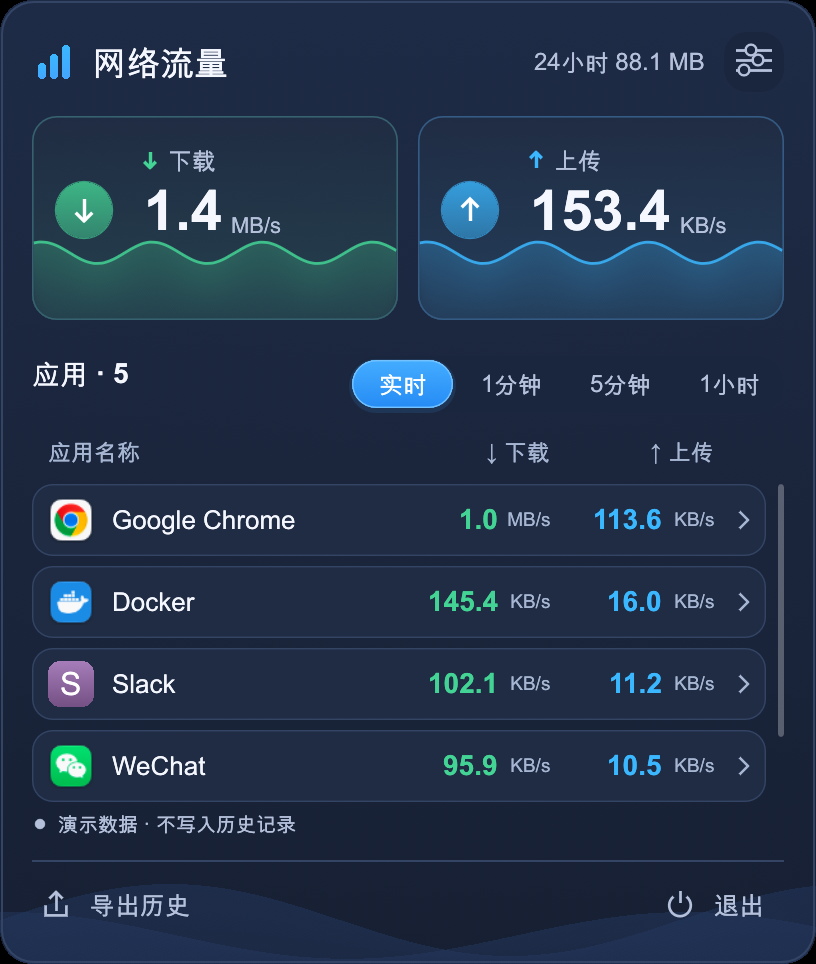
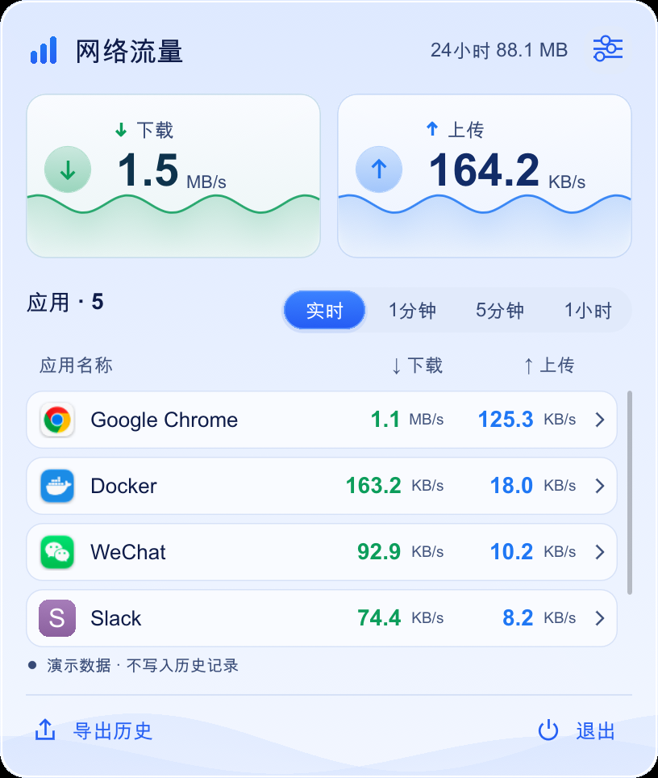
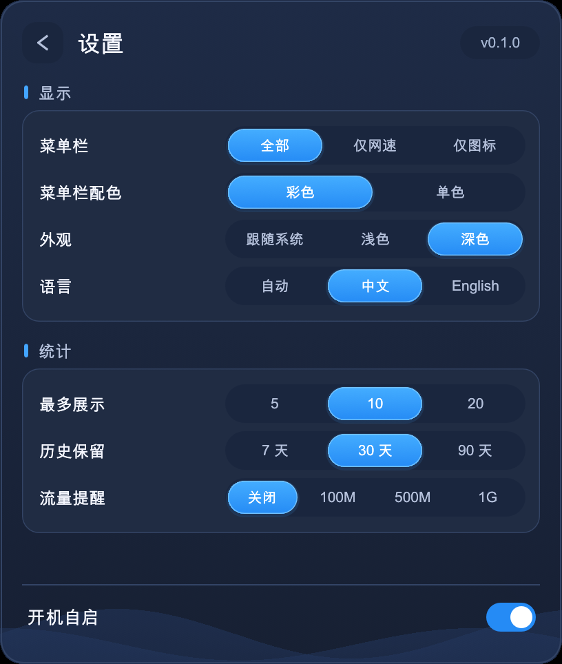
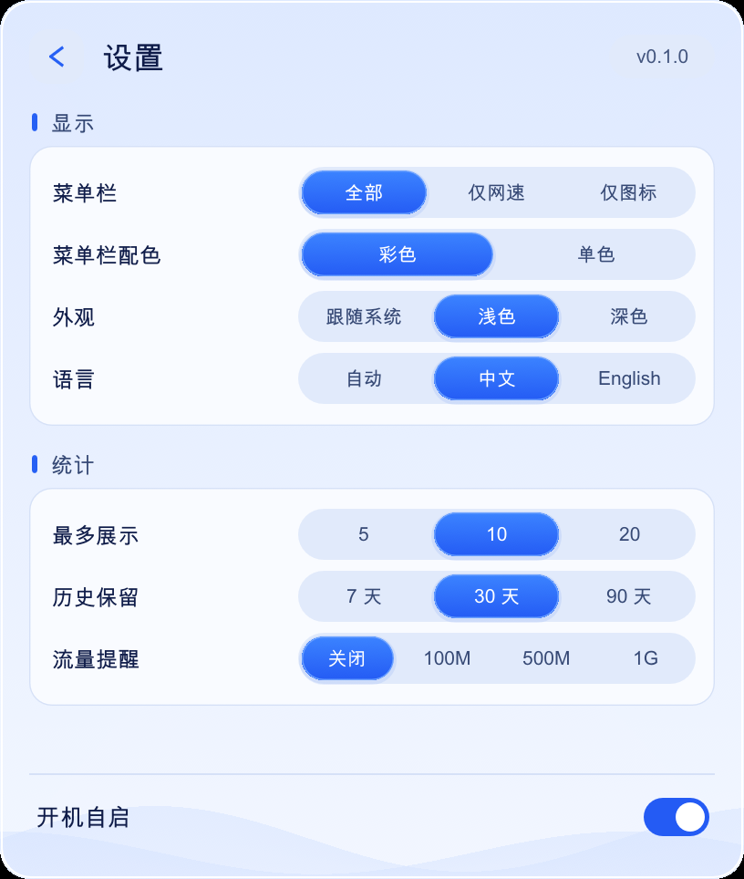
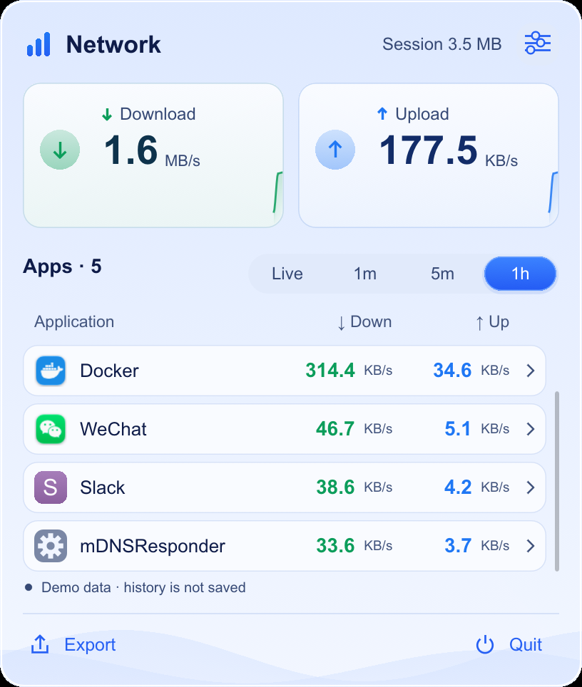
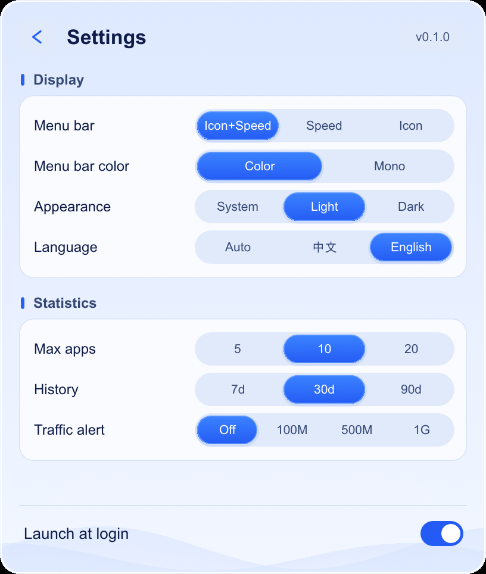

# 2026-11-20 深浅双主题设计

根据「深浅双主题网络流量仪表盘」参考图，调整原生 egui 主面板及设置页。两页共用 408×482 逻辑像素窗口，统一圆角、海军蓝／冰蓝背景、底部波纹、蓝色渐变选中态和下载绿／上传蓝语义色。

## 界面

- 主面板增加柱状网络标识、带方向圆标的双流量卡片和渐变面积曲线；数值与单位分层，长数值限制在本列。
- 趋势由后台保存最近 60 个成功采样点，收起面板仍继续记录；错误或采样源重置时断开旧曲线。上下行使用独立刻度，只表示各自的近期走势；悬停提示说明这一点。
- 应用行使用 23pt 图标、36pt 行高、定宽数字列和右侧箭头。悬停显示完整名称与路径，点击行可查看名称、路径和所选时间窗口的速率。
- 设置页沿用相同背景、卡片、蓝色胶囊选项、返回入口和开关；显示／统计分组、主题、语言、应用数量及其他现有选项保持可用。
- 中英文、加载状态、空状态、状态提示及滚动列表沿用统一布局；演示提示出现时仍可显示四个完整应用行。Tab 焦点有可见描边。
- 修复 `--show` 启动标记被消费后仍会失焦收起的问题，便于隔离预览；通常从托盘打开仍失焦收起。

全部装饰由 egui 矢量绘制，没有引入网页运行时、背景位图或新的第三方依赖。字体从系统读取，缺失时回退；上下行语义色继续由 `tm-core` 统一提供给主面板、macOS 菜单栏和 Windows 任务栏。

## 渲染截图

这些是 macOS 上实际运行 debug 程序返回的 2× 渲染截图，使用隔离目录及内存演示数据。它们用于验证排版，不能证明系统托盘交互或 Windows 实机显示。

| 页面 | 深色 | 浅色 |
|---|---|---|
| 主面板 |  |  |
| 设置 |  |  |

英文及列表滚动到底部：

| 主面板（1 小时） | 设置 |
|---|---|
|  |  |

## 验证

- `cargo test --workspace --locked`：164 项通过，3 项需要原生环境的测试按既有设置忽略。
- 新增真实 egui 输入事件测试，检查深浅主题下设置选项的鼠标点击、时间分段的键盘选择；已有触控板小步滚动、滚轮到底及列表缩短回归通过。
- 严格 Clippy、rustfmt 和差异空白检查通过。
- Apple Silicon 和 Intel 原生 release 构建通过，通用应用的 ad-hoc 签名校验通过；两个架构的空库导出冒烟通过，未创建历史文件。
- Windows 全工作区 Rust 类型检查通过。本机使用临时 `LIBSQLITE3_SYS_USE_PKG_CONFIG=1 PKG_CONFIG_ALLOW_CROSS=1`，不等同于 Windows 原生链接和运行验收；缺少 `rc.exe` 的资源警告保留。
- 桌面控制工具连接预览应用超时，未声称完成系统鼠标点击、托盘开关及真实触控板交互验收。

构建、检查和原始渲染截图保存在 Git 忽略的 `target/design-review/`。截图辅助模块仅编入 debug，且要求同时启用演示模式、隔离数据目录和显式输出路径；release 不包含该模块。

## 使用

macOS 应用为 `dist/Tramoing.app`，安装镜像为 `dist/Tramoing-0.1.0.dmg`。退出旧进程后打开新应用才能加载本次界面。预览使用独立目录，没有改动现有用户设置、历史库或登录项。

DMG 为 7,963,503 字节，SHA256：`04b5eed9607277094bfc5fa7be06cbc305e015ef87ec1019df84e70dd79c4b8b`，同目录保存 `.dmg.sha256` 校验文件。
