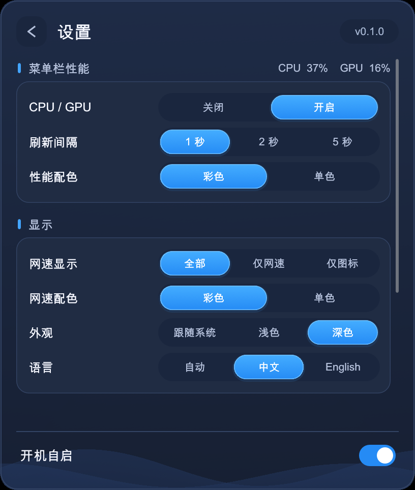
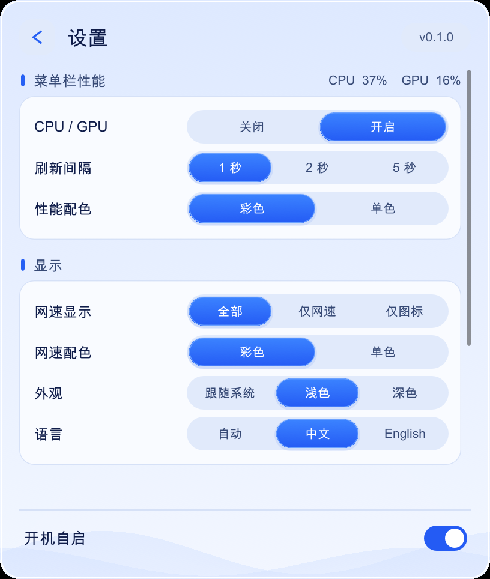
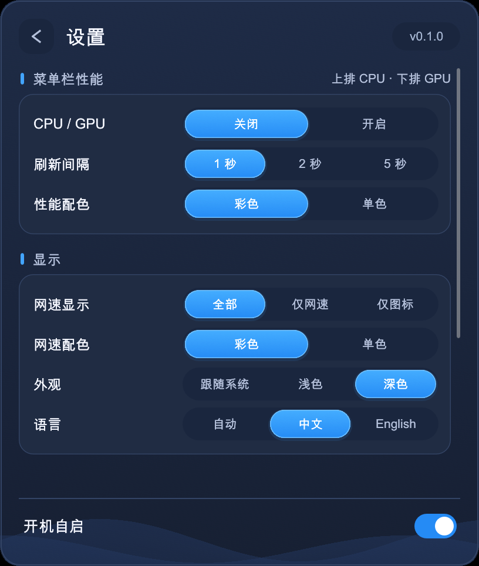
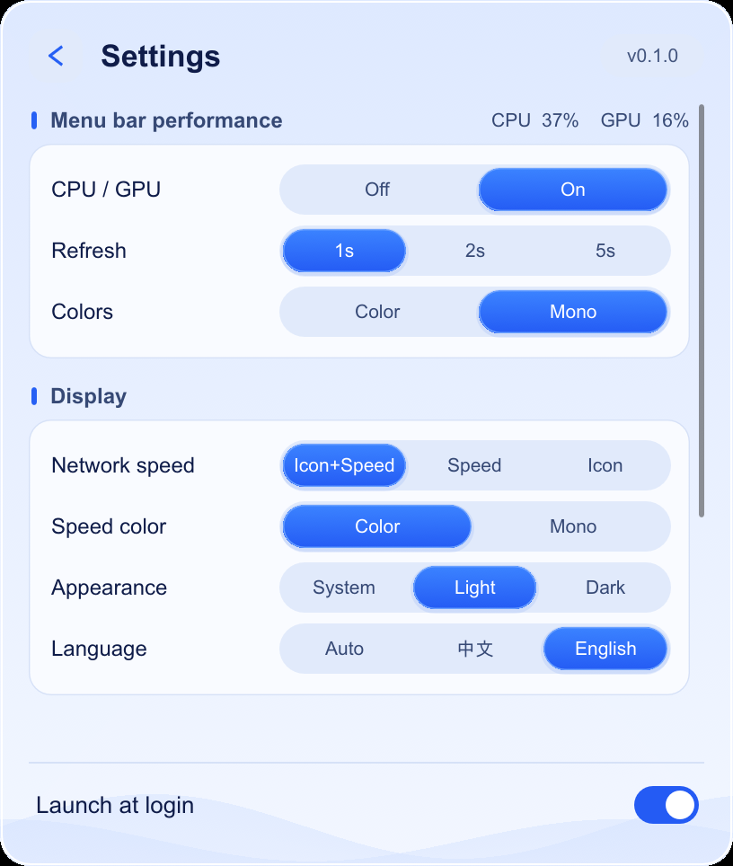

# 2026-11-20 菜单栏 CPU / GPU 双行显示

macOS 菜单栏新增一个性能状态项：**CPU 在上、GPU 在下，共用一个区块**，与网速的上行／下行采用同一套等宽字体、字号、行高及基线。百分比固定四个字符，数值变化不会让菜单栏左右跳动。

```text
CPU  37%
GPU  16%
```

## 设置与行为

- 入口：「设置 → 菜单栏性能」，也可点击性能状态项进入设置。
- 一个「CPU / GPU」总开关，同时控制两行及采样线程，默认关闭；关闭后移除整个性能状态项。
- 刷新间隔：1 / 2 / 5 秒，默认 2 秒，修改后立即生效并保存。
- 彩色模式使用 CPU 蓝、GPU 紫；单色使用系统标签色。菜单栏外观随系统，而面板可单独选择深浅主题。
- 悬停显示精确到一位小数的数值与刷新间隔；没有可用数据时显示 `--%`，不把采样失败显示为 0%。
- 设置中间区域可以滚动；标题、返回和开机自启保持固定。原菜单栏选项改称「网速显示」「网速配色」，明确其控制范围。

配置键：

```ini
performance_enabled=off
performance_color=on
performance_interval=2
```

Windows 不展示这组控件，现有任务栏网速功能保持可用。

## 采集实现

CPU 使用 Mach `host_statistics(HOST_CPU_LOAD_INFO)` 前后两次累计时钟的差值，显示整机所有逻辑核心的平均忙碌比例；首个采样仅建立基线。处理计数器回绕，每次归还主机端口。

GPU 使用 IOKit 的 `IOAccelerator` → `PerformanceStatistics`，优先读取 `Device Utilization %`，其次读取 `GPU Activity(%)`；验证 Core Foundation 类型和数值范围。多 GPU 取最忙设备的百分比，不累加。驱动没有提供这些字段时显示 `--%`。IOKit 对象与 Core Foundation 引用均按生命周期释放。

性能采样使用独立线程，与 nettop 和历史库 I/O 分离，只保存最新值。关闭开关会唤醒并回收线程；过期数据不继续显示。`--mock` 使用明确标注为演示的数据，不写入真实历史。

多个状态项分别持有点击回调，保证性能项和网速项的事件独立；移除状态项时释放对应闭包。

## 渲染验证

以下为隔离 debug 演示实例的 2× 渲染截图；数值为演示数据。菜单栏图像来自原生按钮的离屏渲染，背景透明。

| 彩色双行状态项 | 单色双行状态项 |
|---|---|
|  |  |

| 深色设置 | 浅色设置 |
|---|---|
|  |  |

| 关闭状态 | 英文与单色 |
|---|---|
|  |  |

滚动到底部仍可操作全部统计选项与开机自启：


## 检查结果与范围

- `cargo test --workspace --locked`：172 项通过，4 项原生环境测试按默认配置忽略。覆盖 CPU 差分与回绕、无效 GPU 值、固定宽度、配置兼容、采样启停与过期数据、多个原生点击目标及闭包回收。
- 手动运行被忽略的 `native_cpu_and_gpu_return_percentages`：Apple M1 Pro 实际返回 CPU 43.1%、GPU 0.0%，通过合法范围断言；0.0% 是实际读取结果。
- `cargo fmt --all -- --check`、严格 Clippy 与差异空白检查通过。
- Apple Silicon 与 Intel release 构建通过，通用应用 ad-hoc 签名验证通过；两种架构的空库 `--export` 启动检查均正常退出，且没有创建历史库。
- 独立演示实例在面板隐藏时持续更新菜单文字；12 秒运行日志包含 `frame=30 visible=false` 和多组不同的 CPU / GPU 读数。关闭开关的实例没有创建性能状态项。
- 深色、浅色、关闭状态、英文单色、设置滚动六种运行场景（含隐藏面板）均正常自动退出，没有残留预览进程。
- Windows 全工作区及所有 targets 的类型检查通过；本机使用 `LIBSQLITE3_SYS_USE_PKG_CONFIG=1 PKG_CONFIG_ALLOW_CROSS=1`，缺少 `rc.exe` 的资源警告保留，不等同于 Windows 原生运行验证。
- 原生状态项的离屏尺寸为 67×22 逻辑点，CPU / GPU 是同一标题中的两行。系统返回状态项可见但不在活跃 Space；本轮未完成真实桌面鼠标点击与多显示器验收。

原始截图和日志位于 Git 忽略的 `target/performance-review/`。所有预览使用独立数据目录，没有改动现有用户设置、历史库或登录项。

## 运行

退出旧实例后打开 `dist/Tramoing.app`，进入「设置 → 菜单栏性能」开启 CPU / GPU。安装镜像为 `dist/Tramoing-0.1.0.dmg`。

本次 DMG 为 8,020,196 字节，SHA256：`30b870a47506bb35ff8815f2b6c55ad9084d4d824bd1752ca2b7aabc54eb7d28`；同目录附有 `.dmg.sha256` 校验文件。
