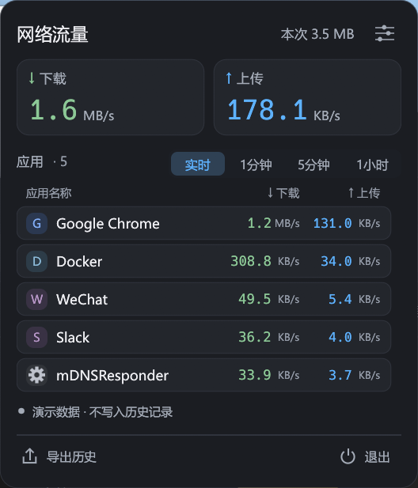
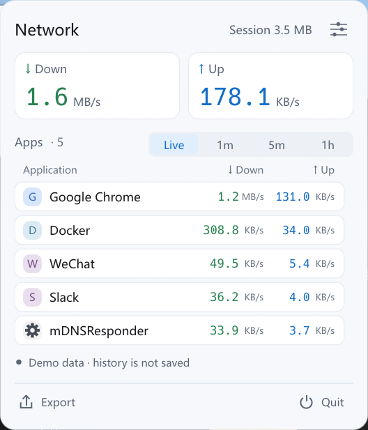
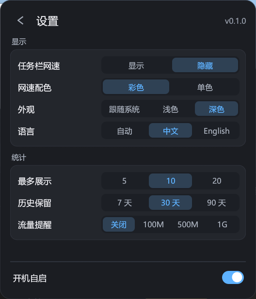
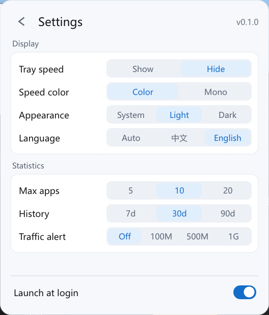

# 2026-11-20 紧凑任务栏与界面优化

本轮依据当前代码启动后的窗口进行检查。仓库原有主面板和设置页截图已过时，已用本轮最终 release 的运行截图替换。

## 改动

- Windows 任务栏网速从 60 缩到 **44 个逻辑像素**，150% 缩放下从 90px 缩到 66px。箭头列从 12 缩到 8 个逻辑像素，数值列与箭头之间仅留 1 个逻辑像素，左右留白收紧。字体、固定箭头和逐像素透明保持原有行为。
- 主面板使用两张等宽速率卡片，数值和单位分开排版；较长数值按卡片可用宽度约束，不覆盖相邻卡片。
- 应用列表增加下载/上传列标题，颜色统一为下载绿、上传蓝；名称按实际字形宽度省略，悬停可读完整名称与路径。长状态文案同样限制在自己的区域中。
- 设置页将「显示」「统计」分组，所有选项控件共用宽度与左起点，选中态、悬停态和明暗主题统一；标题跟在返回按钮旁边，底部自启开关与状态区固定定位。
- 导出和退出采用图标加文字，设置按钮使用完整的 28×28 逻辑像素点击区；演示状态使用中性提示色，错误/超量提示继续使用警告色。
- 两页继续使用 352×411 逻辑像素窗口，切页不改变窗口尺寸。应用行与骨架行共用尺寸，按剩余空间显示整行。

## 验证

- Windows `cargo test -p tray-app -p tm-windows --locked --offline`：60 项通过，1 项交互桌面测试单独通过。
- 严格 Clippy、rustfmt、`git diff --check`：通过。
- Windows 最终 release 构建通过；最终程序的深色中文、浅色英文主面板/设置页均已截图核对。
- 使用隔离测试实例向其窗口发送鼠标消息，验证主题从深色改为浅色、语言从中文改为英文后写入临时设置文件，并返回主面板；未点击开机自启、导出或安装操作。
- 任务栏栅格回归覆盖 100%、125%、150%、200% DPI，明暗与彩色/单色组合，速率变化时箭头区域像素一致。实际字体测量确认 `999M` 等四字符数值能放入紧凑布局。
- 最终 release 原生任务栏运行验证通过：父窗口、透明合成、空白区域点击、单实例、演示数据隔离及退出清理正常，背景采样点与隐藏控件后的任务栏 RGB 最大差值为 0。
- Apple Silicon 和 Intel Mac 的 `tray-app --all-targets` 源码检查通过。本机检查临时使用 `LIBSQLITE3_SYS_USE_PKG_CONFIG=1` 跳过 bundled SQLite C 编译，**不代表 macOS 原生链接和运行验收**。

## 最终安装包

- Windows x64：`dist/Tramoing-0.1.0-setup.exe`，版本仍为 `0.1.0`，大小 **3,287,451 字节（约 3.14 MiB）**。
- NSIS 3.13 编译成功，打包输入与已运行验证的 release 文件 SHA256 一致；未执行安装或覆盖当前已安装程序。
- 安装包 SHA256：`0840C31F798EF01A3F2CFA5857CE5C7AC0534A401CF9FF1E32DCC72E6F742B68`。
- 主程序 SHA256：`8F0CE2163DD4C2F12524ACA5F8C6D0C5F7C1273A656CA9F0656ADFD0222A6D76`。
- 采集助手 SHA256：`B58DF11667A4531B8D5355CCE50D8E17E237A8977FC2E80E7A08FE7F7F76F194`。

安装包和同目录 `.sha256` 校验文件已替换前次同名产物，打包产物不纳入源码提交。

## 当前运行截图

Windows，150% DPI，隔离演示模式；中文字体由系统微软雅黑加载。演示进程只写临时设置文件，历史库在内存中。

| 页面 | 深色中文 | 浅色英文 |
| --- | --- | --- |
| 主面板 |  |  |
| 设置 |  |  |

任务栏网速实屏裁剪：

