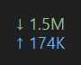

# 2026-11-19 修复与验证记录

本轮目标：保证 Windows/macOS 的计数与采集生命周期正确，把 Windows 网速从独立浮窗改成真正的任务栏子窗口。

## 已实现

| 问题 | 改动 |
| --- | --- |
| Windows ETW 事件错误 | 对照本机 Kernel-Network manifest，Send/Receive 改为 TCPv4 10/11、TCPv6 26/27、UDPv4 42/43、UDPv6 58/59；连接和重传事件不计为新增流量 |
| 图标 mask 内存越界 | 1bpp BITMAPINFO 使用完整的两个 RGBQUAD，加入原生位图读取回归 |
| 重复助手破坏当前采集 | ETW 会话启动/残留清理前先取得全局互斥锁；兼容旧助手时只在管道明确不存在后清理；回收 consumer 的 Arc 和失败会话 |
| 历史 PID 无限积累、协议超限 | 每秒取走 PID 原始增量，独立于 UI 连接；按应用累计，检查进程身份，淘汰空闲应用；极端容量溢出归入明确的汇总行，编码端也检查上限 |
| 首次流量漏记 | RateCalculator 提供整数增量，记账不再从 EMA 显示列表反推；采集器自产累计值的新应用首帧也计入 |
| macOS 新连接与跨帧代理 | 启动帧单独建基线，后续新连接保留初始字节；回环/TUN 归属必须消耗外网预算，先后到达的重复样本不再次计费；解析器保留空帧 |
| 演示污染真实历史 | 显式 mock 使用内存 SQLite 并标识演示状态；真实采集失败不回退到演示；mock 计数器改为逐次累加 |
| 采集失败后旧速率残留 | 超时清空实时速率、显示状态、退避重建采集器；错误写入 ui.log；Windows 管道改成有界轮询，不再遗留读线程 |
| 窗口和提醒时间错误 | 用单调时钟推进窗口，应用共用覆盖时长，空档补零；u64 保留完整字节；提醒直接使用十分钟字节和 |
| 写失败/退出丢待写数据 | 成功提交后才移除队列，按采样分钟保存；App 持有并回收采样线程；退出仍写失败时保存恢复日志，恢复事务幂等 |
| 更新器不能请求管理员权限 | Windows 安装包通过 ShellExecuteExW/runas 启动，区分用户取消 |
| macOS 多屏定位 | 统一按主显示器全局原点翻转坐标，采用状态项所在屏的 visibleFrame |
| 多开 UI | 每用户 OS 文件锁，退出自动释放；再次启动唤醒原实例或进入设置 |
| Windows 网速浮窗 | 原生 Shell_TrayWnd 子窗口、GDI、普通鼠标消息、DPI 布局、窗口丢失重建、禁用/退出清理；删除 egui 网速 viewport 和全局鼠标轮询 |
| 缺少两平台持续检查 | 新增 Windows/macOS CI：测试、严格 Clippy、格式、release 构建和 Mac 两架构检查 |

内部数据目录、管道名、ETW 会话名、计划任务名和 macOS bundle id 保持兼容。自动更新仍默认关闭。

## 本机验证

Windows x86_64，Rust 1.94.0：

- `cargo test --workspace --locked --offline`：125 个通过，1 个交互桌面测试默认忽略。
- 单独执行 `native_child_lifecycle_and_clicks --ignored`：通过。验证实际任务栏父窗口、WS_CHILD、无 TOPMOST、常量 alpha=255 的子窗口合成、位置、点击、窗口丢失恢复与销毁清理。
- `cargo clippy --workspace --all-targets --locked --offline -- -D warnings`：通过。
- `cargo fmt --all -- --check`：通过。
- Windows debug/release 两个可执行程序构建：通过。
- 使用独立临时目录启动 `tramoing --mock`：实际进程的网速窗口父窗口为任务栏、WS_CHILD 为真、TOPMOST 为假；第二实例正常退出；mock 未创建真实历史库；WM_CLOSE 后进程正常退出并移除子窗口。

Apple Silicon 与 Intel macOS：

- 两架构完整 workspace、all-targets 的 Rust 类型检查通过。
- Apple Silicon 全 workspace 严格 Clippy 通过。
- macOS 的 21 个纯连接解析/记账测试已在 Windows 上执行。
- 完整源码检查临时使用 `LIBSQLITE3_SYS_USE_PKG_CONFIG=1` 跳过 bundled SQLite 的 C 编译。该设置只用于本机检查，未写入项目构建配置。Windows 不具备 macOS SDK/C 工具链，**这些结果不代表 macOS 已完成原生链接、打包或运行验收**。CI 在 Mac 上按默认 bundled 配置构建。

## Windows 安装包（2026-11-20）

- 产物：`dist/Tramoing-0.1.0-setup.exe`，包含 Windows x64 主程序和采集助手；版本沿用 `0.1.0`。
- 使用 NSIS 3.13 编译成功，安装包大小为 **3,282,262 字节（约 3.13 MiB）**；文件版本和产品版本均为 `0.1.0`。
- 打包前用 `cargo build --release --locked --offline` 分别重新确认两个程序构建成功，并校验 `dist/windows` 中的文件与已通过原生任务栏运行验证的 release 文件一致。
- 本轮 release 使用独立的 `CARGO_TARGET_DIR`，因此从该目录明确复制两个程序至 `dist/windows`，再执行 `makensis /DAPP_VERSION=0.1.0 packaging/windows/traffic-monitor.nsi`。现有 `build.ps1` 的收集路径固定为 `target/release`，自定义构建目录时也需同步调整收集路径。
- 安装包 SHA256：`E745D5E7AD51196AAE4C4FDFAC768EBF6BEC232A58ACB28FB92D9C602B67E66F`，同目录附有 `.sha256` 校验文件。
- 包内主程序 SHA256：`944CC510B405BBB8D41406CB2CA4B378C086ACDD332D0F5338CF7760FA760362`。
- 包内采集助手 SHA256：`BC692584453DCB1CF3C77ACC4730D14DD8C05C849C0BBC3C03BCEE9D57A407B6`。

本次完成安装包生成及打包输入校验，未执行安装或覆盖升级。当前机器上已安装的程序和采集助手未被替换。`dist` 中的安装包、校验文件和验证用压缩包均不纳入源码提交。

## 仍需平台验收的边界

- **Win11** 没有公开的任意文字任务栏扩展 API。本控件是真正的原生子窗口，但使用可识别的现有空位，不能保证所有未来版本或第三方 Shell 都能预留布局。空间不够会隐藏并提示；Win10 经典任务栏才会调整任务按钮区预留位置。
- 当前本机验证覆盖 Win11 的当前任务栏布局和 150% DPI 下的实际文字显示。Win10、真实 Explorer 重启、自动隐藏动画、全屏游戏、任务按钮数量变化、200% 与混合 DPI、多显示器需要进一步人工验收。控件目前使用主题实色背景，未复制系统亚克力效果。
- macOS 代理流量跨帧时优先保持外网总量守恒。已经先记入代理的字节不会再转移历史归属，因此迟到的回环样本可能有一部分留在代理名下；TUN 进程识别仍是启发式。不能承诺所有 VPN/多级代理都能精确回填给客户端。
- ETW 事件表已对照系统元数据验证，仍需用新版管理员助手做 TCP/UDP、IPv4/IPv6 的定量端到端传输验收。本轮未替换或重启用户已经安装的助手。
- 单实例防重入在新版之间有效；升级时应退出旧版 UI，因为旧版没有实例锁。
- 硬终止进程仍可能丢失上次五秒提交之后的内存数据；磁盘完全不可写时数据库和恢复文件均无法保存。正常退出和数据库暂时锁定有重试/恢复路径。

新增 CI 配置尚未上传触发；当前结论来自上述本地执行结果。

实屏裁剪（150% DPI，演示流量）：

可使用 scripts/verify-windows-runtime.ps1 重复隔离运行、单实例、正常退出及高 DPI 截图检查。
